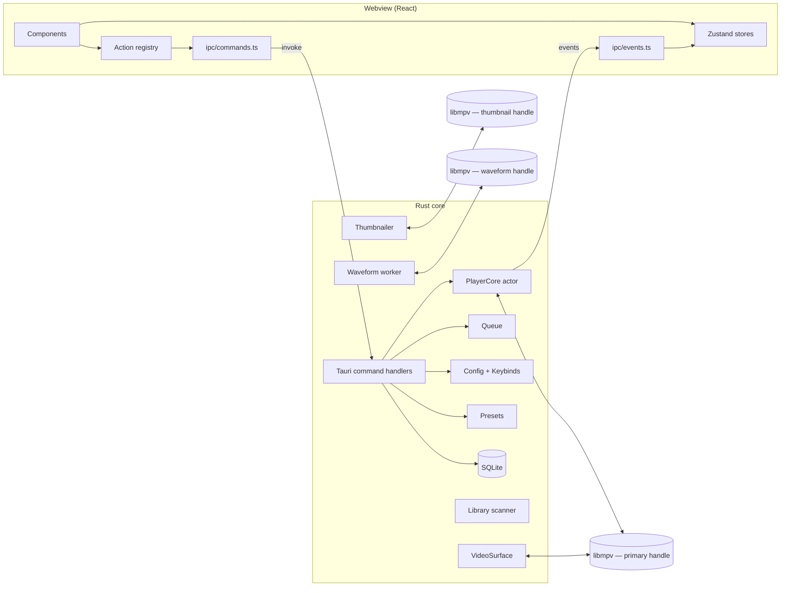
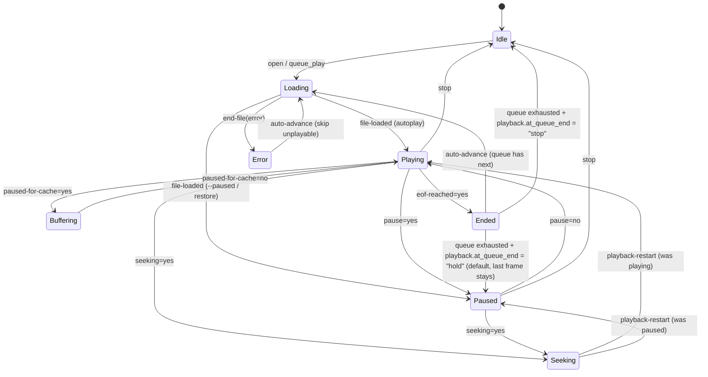

# vihpluh — Architecture

Source of truth for the technical design: stack, process model, video pipelines, IPC contracts,
storage schemas, and build/runtime dependencies. Companion docs:
[DESIGN_SYSTEM](DESIGN_SYSTEM.md) · [KEYBINDS_AND_CONFIG](KEYBINDS_AND_CONFIG.md) · [IMPLEMENTATION_PLAN](IMPLEMENTATION_PLAN.md).

Items marked **⚠ VERIFY (Sx)** are assumptions that a named Phase 1 spike must confirm before code
depends on them (IMPLEMENTATION_PLAN §3). Items marked **✔ VERIFIED (Sx)** were confirmed by that spike
on Windows (2026-11-12, pinned libmpv 0.42.0-38); the remaining ⚠ markers all belong to S2, which needs
the bare-metal Fedora machine.

## Contents

1. [Goals and non-goals](#1-goals-and-non-goals)
2. [Stack decision](#2-stack-decision)
3. [Repository layout](#3-repository-layout)
4. [Runtime architecture](#4-runtime-architecture)
5. [Video surface and hardware decoding](#5-video-surface-and-hardware-decoding)
6. [Player core](#6-player-core)
7. [IPC contract](#7-ipc-contract)
8. [Queue, playlists, library](#8-queue-playlists-library)
9. [Storage and schemas](#9-storage-and-schemas)
10. [Presets and auto-matching](#10-presets-and-auto-matching)
11. [Media services: thumbnails, waveform, subtitle cues](#11-media-services)
12. [Build and runtime dependencies](#12-build-and-runtime-dependencies)
13. [Packaging, licensing, security](#13-packaging-licensing-security)
14. [Performance budgets](#14-performance-budgets)
15. [Decision log and open risks](#15-decision-log-and-open-risks)

---

## 1. Goals and non-goals

**Goals**

- Play anything mpv plays, including high-bitrate 4K HEVC/AV1 MKV, with hardware decoding and no dropped frames.
- A custom, compact, auto-hiding UI (Juxtopposed-inspired) that never obscures or interrupts playback.
- Keyboard-first: every action bindable, every shortcut discoverable.
- Windows 10/11 and Fedora (Wayland + X11) at feature parity, from one codebase.
- Per-show presets, a transient queue separate from persistent playlists, a compact library.
- Human-readable, file-based configuration that lives outside the repo.

**Non-goals (v1)**

- macOS, mobile, 32-bit, ARM64 builds (nothing should preclude them; nothing is done for them).
- Media server / casting / DLNA / Chromecast, disc menus (DVD/Blu-ray navigation), transcoding, recording.
- Online metadata scraping (posters, TMDB), accounts, sync, telemetry, auto-update.
- Plugin/extension system. mpv Lua scripts are not loaded (`load-scripts=no`).
- HDR passthrough on Linux (tone-mapped SDR output only; see §5.3).
- IPTV EPG (programme guide). Channel lists only.

---

## 2. Stack decision

### 2.1 Locked stack

| Layer | Choice | Notes |
|---|---|---|
| App shell | **Tauri 2** (2.11.x at time of writing) | System webview: WebView2 (Windows), WebKitGTK 4.1 (Linux). |
| Core language | **Rust** stable, edition 2024 | Single `vihpluh` binary. |
| Playback engine | **libmpv** ≥ 0.40 (client API 2.x); develop against 0.42 | Bound through **`libmpv2-sys`** (the raw bindings of the `libmpv2` crate family, pregenerated — no bindgen/libclang needed) behind our own thin safe wrapper, `player/mpv.rs` (D14). |
| UI | **TypeScript + React 19 + Vite + Tailwind CSS 4** | Zustand (state), Radix UI primitives (unstyled a11y behavior), dnd-kit (drag/drop), `@tanstack/react-virtual` (long lists). |
| IPC typing | **`ts-rs`** | Rust DTOs derive `TS`; bindings generated into `src/ipc/bindings/`. (`tauri-specta` rejected: still release-candidate.) |
| Persistence | **TOML** (`toml` + `toml_edit`), **JSON** (`serde_json`), **SQLite** (`rusqlite`, bundled) | See §9. |
| OS integration | `souvlaki` (media keys, SMTC on Windows, MPRIS on Linux), `notify` (file watching), `directories` (paths) | |
| Tauri plugins | `single-instance`, `dialog`, `window-state`, `opener` | Nothing else without justification. |
| Tooling | pnpm, Biome, Vitest, cargo fmt/clippy/test, GitHub Actions | |

Pin exact versions in `Cargo.lock` / `pnpm-lock.yaml` when scaffolding; the majors above are the contract.

### 2.2 Why this and not the alternatives

| Criterion | **Tauri 2 + Rust + libmpv + React** | Python + PySide6 + python-mpv | Qt 6 / QML (C++ or cxx-qt) + libmpv |
|---|---|---|---|
| Windows decode path | **Best.** mpv owns a native D3D11 surface: `gpu-next`, zero-copy `d3d11va`, HDR passthrough. | Render API only → OpenGL → `d3d11va-copy`, no HDR passthrough. | Same render-API limits as PySide6. |
| Linux Wayland | Render API into `GtkGLArea` under the webview. Needs a spike (S2). | Render API in `QOpenGLWidget`. Proven. | Render API in Qt Quick FBO. Proven. |
| Bespoke UI velocity | **Best.** HTML/CSS for a fully custom design system, sliders, timelines, canvas waveforms. | QSS styling is limiting; custom widgets are slow to build. | QML is capable but slower to iterate; smaller ecosystem. |
| Cold start / footprint | ~10 MB app + system webview. Fast start. | Slow interpreter start, 150 MB+ bundle. | Fast, but ~60–100 MB Qt runtime to ship. |
| Core robustness | Rust: threads, FFI, no GIL. | GIL contention between mpv events, scanning, thumbnailing. | C++ robust but more footguns; cxx-qt adds friction. |
| Packaging | NSIS/MSI and RPM from one bundler. | PyInstaller/Nuitka per-OS pain. | windeployqt + RPM, manageable. |
| Main risk | Linux compositing of GL video under a transparent webview. | Daily-driver performance and UI ceiling. | Windows video quality ceiling, UI build cost. |

**Verdict.** Development starts on Windows and Windows is the daily driver; Tauri is the only option
that gives mpv a native D3D11 surface there while keeping a fully custom UI. The price is a harder
Linux integration, which is isolated behind one trait (§5.1), de-risked by spike S2 before any feature
work, and has a defined contingency (§4.5). PySide6 loses on startup, footprint, and concurrency. Qt/QML
is the strongest alternative and is the fallback of last resort if both S2 and the contingency fail.

### 2.3 The central constraint

libmpv can present video in two ways, and no single one is best everywhere:

| Mode | How | Renderer | Works on |
|---|---|---|---|
| **Embed** (`--wid`) | mpv creates its own child window + GPU context inside a window we give it. | Full `gpu-next`, any `gpu-api` (D3D11/Vulkan), native zero-copy hwdec, HDR passthrough. | Windows. *Not* Wayland (no foreign-window embedding exists). *Not* GTK/X11 with an overlay (an X child window paints above all GTK content, hiding the webview). |
| **Render API** (`vo=libmpv`) | mpv draws into an OpenGL framebuffer we own. | Classic `gpu` renderer, OpenGL only. Hwdec limited to what interops with our GL context. **⚠ VERIFY (S2)** that 0.42 still backs `vo=libmpv` with `gpu`, not `gpu-next`. | Everywhere. Required on Linux. |

So vihpluh ships **two video backends behind one trait**: Embed on Windows, Render on Linux.
The UI and the rest of the core cannot tell them apart except through the `capabilities` object.

---

## 3. Repository layout

Target tree. Create directories only as their phase needs them.

```
vihpluh/
├── CLAUDE.md  README.md  LICENSE  .gitignore  .gitattributes
├── docs/
│   ├── ARCHITECTURE.md  DESIGN_SYSTEM.md  IMPLEMENTATION_PLAN.md  KEYBINDS_AND_CONFIG.md
├── package.json  pnpm-lock.yaml  vite.config.ts  tsconfig.json  biome.json  index.html
├── scripts/
│   ├── fetch-libmpv.ps1          # Windows: download + verify pinned libmpv, generate mpv.lib
│   ├── check-deps.sh             # Fedora: verify dnf packages, codecs, VA-API/NVDEC
│   ├── gen-bindings.mjs          # runs the ts-rs export tests (output dir set in .cargo/config.toml)
│   └── tauri.mjs                 # Tauri CLI wrapper: `dev` gets VIHPLUH_HOME=./.local
├── src/                          # ── frontend ──
│   ├── main.tsx  App.tsx
│   ├── ipc/
│   │   ├── transport.ts          # the ONLY file importing @tauri-apps/api (invoke/listen/window)
│   │   ├── commands.ts           # typed wrapper per Tauri command
│   │   ├── events.ts             # typed subscribe helpers
│   │   └── bindings/             # generated by ts-rs — do not edit
│   ├── stores/                   # zustand: player, time, queue, tracks, config, library, ui
│   ├── actions/
│   │   ├── registry.ts           # ActionId → { run, isEnabled, label, icon }
│   │   └── definitions/          # one file per domain (player, window, subtitles, …)
│   ├── keybinds/                 # engine.ts (match + dispatch), normalize.ts (event → key string)
│   ├── components/               # design-system primitives (Button, IconButton, Slider, ConeSlider,
│   │                             #  Menu, Popover, Tabs, Tooltip, Toggle, Select, NumberField, …)
│   ├── features/
│   │   ├── chrome/               # TopBar, BottomBar, SeekBar, VolumeCone, TrackPopovers,
│   │   │                         #  ContextMenu, Osd, useAutoHide
│   │   ├── sidebar/              # Sidebar + tabs/{Subtitles,Audio,Video,Playback,Bookmarks}
│   │   │                         #  SubtitleTimeline, Equalizer, Inspector
│   │   ├── queue/  library/  presets/  settings/  pip/  idle/
│   ├── icons/                    # mono/*.svg, duotone/*.svg, index.ts
│   ├── styles/                   # tokens.css, base.css
│   └── lib/                      # time.ts, format.ts, color.ts, naturalSort.ts …
└── src-tauri/
    ├── Cargo.toml  build.rs  tauri.conf.json
    ├── capabilities/default.json
    ├── icons/
    ├── lib/windows-x64/          # libmpv-2.dll, mpv.lib, include/  (gitignored, fetched)
    ├── resources/
    │   ├── default.toml          # shipped config defaults (embedded with include_str!)
    │   ├── keymaps/{vihpluh,vlc,mpv}.toml
    │   ├── eq-presets.toml
    │   └── shaders/{flip_h,flip_v}.glsl
    └── src/
        ├── main.rs               # env setup (before GTK init), CLI parse, run()
        ├── lib.rs                # tauri::Builder wiring
        ├── cli.rs  error.rs  paths.rs  logging.rs  window.rs  bookmarks.rs
        ├── ipc/
        │   ├── dto.rs            # all types crossing IPC (derive Serialize, Deserialize, TS)
        │   ├── events.rs         # event names + emit helpers
        │   └── commands/         # player.rs tracks.rs audio.rs sub.rs video.rs queue.rs
        │                         #  bookmark.rs preset.rs library.rs playlist.rs config.rs
        │                         #  window.rs media.rs app.rs debug.rs (debug builds only)
        ├── player/
        │   ├── mod.rs            # PlayerCore actor + PlayerHandle
        │   ├── mpv.rs            # thin safe wrapper over libmpv2 / libmpv2-sys
        │   ├── state.rs          # PlayerState + reducer
        │   ├── observe.rs        # property observation table
        │   ├── hwdec.rs          # decode-chain selection (§5.4)
        │   ├── options.rs        # mpv init options (§6.2)
        │   ├── tracks.rs  filters.rs  equalizer.rs  sleep.rs
        ├── video/
        │   ├── mod.rs            # trait VideoSurface, Capabilities
        │   ├── embed_win.rs      # Windows: child HWND + --wid
        │   └── render_gtk.rs     # Linux: GtkGLArea + mpv_render_context
        ├── queue/                # mod.rs (Queue), session.rs (persist/restore)
        ├── config/               # mod.rs, schema.rs, migrate.rs, keybinds.rs
        ├── presets/              # mod.rs, matcher.rs, series.rs
        ├── subtitles/            # cues.rs (srt/ass/vtt), mkv.rs, automatch.rs
        ├── media/                # identity.rs (oshash), thumbs.rs, waveform.rs
        ├── library/              # db.rs, migrations/*.sql, scan.rs, music.rs, iptv.rs, playlists.rs
        └── platform/             # mod.rs (trait), windows.rs, linux.rs — power inhibit,
                                  #  media keys, decorations, session detection
```

---

## 4. Runtime architecture

### 4.1 Process and thread model

One process. No sidecars, no external `mpv` executable.



| Thread | Owns | Rules |
|---|---|---|
| Main (Tauri/tao event loop; GTK main loop on Linux) | Windows, webview, `VideoSurface`. | Never blocks. On Linux all GL calls happen here inside `GtkGLArea::render`. |
| `mpv-events` | Loop on `mpv_wait_event` for the primary handle. | Translates mpv events → `CoreEvent`, sends on a channel. Calls no mpv API that can block on itself. |
| `core` (PlayerCore actor) | `PlayerState`, `Queue`, sleep timer, resume tracking. | Single-threaded reducer: consumes `CoreEvent` + `CoreCommand`, mutates state, emits IPC events. |
| Tokio pool (Tauri runtime) | Command handlers, config/preset file I/O. | `spawn_blocking` for anything touching disk/DB. |
| `db` | The one `rusqlite::Connection`. | All SQL goes through a request channel. WAL mode. |
| `thumbs` | Thumbnail mpv handle + software render context. | Latest-request-wins queue. |
| `waveform` | Waveform mpv handle (one job at a time). | Low priority; cancellable. |
| `scan` | Library scanning + `notify` watcher. | Low priority; batches DB writes. |

libmpv's client API is thread-safe, so `PlayerHandle` (cheap clone) may issue `mpv_command_async` /
`mpv_set_property_async` from command handlers directly; **state changes still arrive only through the
event thread**, so there is exactly one path by which `PlayerState` mutates.

### 4.2 State ownership

| State | Owner | Frontend copy |
|---|---|---|
| Playback (status, tracks, volume, delays, filters…) | `player::state::PlayerState` (mirror of mpv properties) | `stores/player.ts`, updated by `player://patch` |
| Position/duration/cache | mpv → core | `stores/time.ts` (ref-based, interpolated per frame) |
| Queue | `queue::Queue` | `stores/queue.ts` |
| Config, keybinds | `config::ConfigStore` | `stores/config.ts` |
| Presets, bookmarks, library, playlists | Rust + files/SQLite | fetched on demand, cached per view |
| Panel open/closed, active tab, hover, drag, drafts | **Frontend only** (`stores/ui.ts`) | — (open panels and last tab are saved to `session.json` via `session_ui_set`, never to `config.toml`) |

### 4.3 Startup sequence

1. `main()`: resolve paths (§9.1) → init logging → load config (defaults ⊕ user file) → set process
   env that must precede toolkit init (Linux: `WEBKIT_DISABLE_DMABUF_RENDERER`, `GDK_BACKEND` overrides; §5.3).
2. Parse CLI (§4.6). If another instance is running, `single-instance` forwards argv to it and this process exits.
   On Windows this is detected *before* mpv starts (the plugin's hidden `<identifier>-siw` window), so a
   forwarding launch never opens the file itself (D20). On Linux the plugin uses D-Bus and the check happens
   inside Tauri start-up, after mpv has started; acceptable until it shows up as a problem.
3. Create the `VideoSurface` for the platform and the primary mpv handle with init options (§6.2); start
   the `mpv-events` and `core` threads; apply the CLI open-request if any. This happens **before** Tauri
   starts, so mpv brings up its video output and opens the first file while the webview (the slow part of
   startup, ~350 ms) initialises (D18). Nothing on this path may wait on mpv's core.
4. Build Tauri app; create main window **hidden**, transparent, undecorated (unless `interface.window_decorations = "native"`).
   The window is declared in `tauri.conf.json` with `"create": false` and built in `setup` so its webview
   storage can be pointed at `<data>/webview` (keeps `--home` / portable mode self-contained).
   Then `Player::attach` binds the surface into the window and gives the core its `AppHandle`.
5. Start the `db` thread. Open DB, run migrations.
6. Restore session (queue) if `general.restore_session`.
7. Frontend mounts → calls `app_info`, `config_get`, `keybinds_get`, `player_snapshot`, `queue_snapshot` in parallel → subscribes to events → signals `app_ready` → Rust shows the window.

The window is shown only after first paint to avoid a white/transparent flash.

### 4.4 Shutdown

`window close` / `app.quit` → core persists position + session → `mpv_terminate_destroy` on all handles
(render context freed first on Linux, on the main thread with the GL context current) → DB checkpoint → exit.
A 2-second watchdog force-exits if mpv hangs on a dead network stream.

### 4.5 Transport isolation (contingency hook)

Only `src/ipc/transport.ts` imports `@tauri-apps/api`. It exposes `invoke<T>(cmd, args)`, `listen<T>(event, cb)`,
`binary(cmd, args)`, and window helpers. If the Linux GTK3/WebKitGTK compositing path proves unusable
(S2 fails), the contingency is a Linux-only shell built on `gtk4` + `webkit6` crates hosting the same
frontend bundle and the same Rust core, with `transport.ts` swapped for a `window.webkit.messageHandlers`
bridge. This rule costs nothing now and keeps that door open.

### 4.6 CLI

```
vihpluh [OPTIONS] [FILES_OR_URLS]...

  --enqueue             Add to the running instance's queue instead of replacing it
  --play-next           Insert after the current item
  --start <TIME>        Start position: seconds, mm:ss, hh:mm:ss, or N%
  --fullscreen | --pip | --zen
  --paused              Load without starting playback
  --no-resume           Ignore saved resume position
  --no-session          Do not restore or save the session queue
  --preset <ID>         Force a preset for the opened items
  --home <DIR>          Use DIR as the config/data/cache root (portable mode)
  --log-level <error|warn|info|debug|trace>
  --mpv-opt <K=V>       Extra raw mpv option (repeatable; applied before init)
  -V, --version         Print version, mpv/ffmpeg versions, video backend
  -h, --help
```

Parsed with `clap`. Directories expand to their media files (natural sort, non-recursive). `.m3u/.m3u8`
arguments expand to their entries. On Windows the binary is a GUI-subsystem app; `--help`/`--version`
attach to the parent console (`AttachConsole(ATTACH_PARENT_PROCESS)`) before printing.

---

## 5. Video surface and hardware decoding

### 5.1 The `VideoSurface` trait

```rust
pub trait VideoSurface: Send + Sync {
    /// mpv options that must be set before mpv_initialize (vo, wid, gpu-api, …).
    fn init_options(&self) -> Vec<(&'static str, String)>;
    /// Called once on the main thread when the main window exists (mpv is already initialised):
    /// moves the surface into the window; creates the render context where applicable.
    fn bind(&self, window: &tauri::WebviewWindow, mpv: &Mpv) -> Result<(), VideoError>;
    /// Tear down GPU resources. Must run before the mpv handle is destroyed.
    fn detach(&self);
    fn capabilities(&self) -> Capabilities;
}

// video::create(&config) builds the surface *before* the window exists (D18).

pub struct Capabilities {            // serialised to the frontend via app_info
    pub backend: Backend,            // Embed | Render
    pub session: Session,            // Windows | Wayland | X11
    pub renderer: Renderer,          // GpuNext | Gpu
    pub hdr_passthrough: bool,
    pub window_positioning: bool,    // false on Wayland
    pub always_on_top: bool,         // false on Wayland (compositor-controlled)
    pub native_decorations: bool,    // SSD available?
    pub gpu_vendor: GpuVendor,       // Nvidia | Amd | Intel | Other
}
```

The video viewport inside the window is **not** controlled by moving native surfaces. Panels that dock
beside the video shrink the picture through mpv's `video-margin-ratio-{left,right,top,bottom}` properties
(command `video_set_margins`), which works identically on both backends and can be animated.

### 5.2 Windows — Embed backend (`embed_win.rs`)

```
┌ Tauri window (HWND, undecorated, transparent) ───────────────┐
│  ┌ WebView2 child HWND — transparent background, TOP ──────┐ │
│  │   React UI; pixels with alpha 0 show the layer below    │ │
│  └─────────────────────────────────────────────────────────┘ │
│  ┌ "vihpluh-video" child HWND (ours), BOTTOM of z-order ───┐ │
│  │   mpv child window + D3D11 flip-model swapchain         │ │
│  └─────────────────────────────────────────────────────────┘ │
└──────────────────────────────────────────────────────────────┘
```

- Create our own host window and pass its handle as `wid`. It starts life as a hidden top-level
  `WS_POPUP` (tool window, never activated) so mpv can initialise before the main window exists; `bind`
  then reparents it (`SetParent`) as a `WS_CHILD | WS_CLIPCHILDREN` window sized to the client area at
  `HWND_BOTTOM`, and resizes it on the parent's `WM_SIZE` (window subclass). Owning the host (rather than
  passing the top-level HWND) gives deterministic z-order below WebView2.
- **The host must not have `WS_CLIPSIBLINGS`.** WebView2's window sits above it and is opaque as far as
  USER is concerned, so sibling clipping reduces the host's visible region to nothing and DWM then culls
  mpv's swapchain completely: the window shows the desktop instead of the video (found in S1). Windows
  forces that bit onto top-level windows, so it is cleared again *after* `SetParent`.
- GDI content in the transparent top-level window has alpha 0, so the host's own background is invisible;
  only mpv's swapchain paints. While idle with no VO the window is see-through unless the web UI paints
  (the idle screen paints `--bg-base`).
- Window config: `transparent: true`, `decorations: false`, `shadow: true`. Page `html, body { background: transparent }`.
- All input goes to WebView2. mpv input is disabled (`input-default-bindings=no`, `input-vo-keyboard=no`, `input-cursor=no`, `cursor-autohide=no`).
- Init options: `vo=gpu-next`, `gpu-api=d3d11`, `gpu-context=d3d11`, `wid=<hwnd>`, `target-colorspace-hint=auto`.
- HDR: with the display in HDR mode, `gpu-next` + D3D11 passes HDR10 through; otherwise tone-maps per `video.tone_mapping`.
- **✔ VERIFIED (S1):** transparent WebView2 composites over the sibling child HWND during playback, resize, and
  maximize/restore; a 50 %-alpha box and a CSS animation render over 4K HDR video; all pointer input reaches the
  webview; `hwdec-current = d3d11va`. Fullscreen is re-checked in Phase 3 (needs `window_set_mode`); a
  monitor/DPI change could not be exercised on the single-display dev machine and stays on the Phase 11 list.

### 5.3 Linux — Render backend (`render_gtk.rs`)

```
GtkApplicationWindow (Tauri/tao, GTK3)
└── GtkBox (tao default vbox)
    └── GtkOverlay                         ← inserted by render_gtk.rs
        ├── GtkGLArea        (main child)  ← mpv renders here
        └── WebKitWebView    (overlay)     ← transparent background, receives all input
```

- After window creation: take the `WebKitWebView` out of tao's vbox (`WebviewWindow::default_vbox()` /
  `with_webview`), create a `GtkOverlay`, add a `GtkGLArea` as its child and the webview with
  `add_overlay`, pack the overlay into the vbox. Window is created with `transparent: true` so the webview background is RGBA(0,0,0,0).
- `GtkGLArea::realize` → `make_current` → create `mpv_render_context` with:
  - `MPV_RENDER_PARAM_API_TYPE = "opengl"`
  - `MPV_RENDER_PARAM_OPENGL_INIT_PARAMS { get_proc_address }` (resolve through `libepoxy`: `eglGetProcAddress` on Wayland, `glXGetProcAddressARB` on X11)
  - `MPV_RENDER_PARAM_WL_DISPLAY` (from `gdk_wayland_display_get_wl_display`) **or** `MPV_RENDER_PARAM_X11_DISPLAY` (from `gdk_x11_display_get_xdisplay`) — required for hwdec interop
  - `MPV_RENDER_PARAM_ADVANCED_CONTROL = 1`
- `mpv_render_context_set_update_callback` → `glib::idle_add_once` → `gl_area.queue_render()` (callback fires on an mpv thread; never touch GTK there).
- `GtkGLArea::render` → read `GL_FRAMEBUFFER_BINDING` → `mpv_render_context_render` with `MPV_RENDER_PARAM_OPENGL_FBO { fbo, w, h }`
  (w/h = allocation × `scale_factor`) and `FLIP_Y = 1` → `mpv_render_context_report_swap`.
- Init options: `vo=libmpv`, `gpu-hwdec-interop=auto`.
- Screen-sleep inhibition is the app's job here (mpv has no window): `platform/linux.rs` calls `GtkApplication::inhibit(IDLE)` while video is playing.

**Wayland vs X11**

| | Wayland | X11 |
|---|---|---|
| Detection | Actual GDK backend of the default display (`is_wayland`), not just `WAYLAND_DISPLAY`. `GDK_BACKEND=x11` forces XWayland. | `DISPLAY` set and GDK backend is X11. |
| GL context under `GtkGLArea` | EGL | GLX (GTK3 has no EGL-on-X11) **⚠ VERIFY (S2)** |
| VA-API | Zero-copy via EGL dmabuf import (`hwdec=vaapi`). | No EGL → no zero-copy VA-API. Uses `vaapi-copy` (hardware decode + readback). |
| NVDEC | `hwdec=nvdec` (CUDA↔GL interop). | `hwdec=nvdec`. |
| Vulkan Video | `vulkan-copy` only (zero-copy needs a Vulkan VO, which the render API cannot provide). | Same. |
| Decorations | GNOME/Mutter has no server-side decorations → vihpluh draws its own title bar (CSD). KDE supports SSD (`interface.window_decorations = "native"`). | SSD from the window manager is available. |
| Window positioning / always-on-top | Not available to clients. PiP cannot self-position or pin (see DESIGN_SYSTEM §9). | Available. |
| Fractional scaling | GTK3 rounds to integer scale and the compositor downsamples; video FBO is sized in device pixels so the picture stays sharp. | n/a |

**Environment handling (set in `main()` before any GTK/WebKit init):**

| Variable | When vihpluh sets it | Config override |
|---|---|---|
| `WEBKIT_DISABLE_DMABUF_RENDERER=1` | NVIDIA proprietary driver detected on Wayland (known WebKitGTK blank/garbled-webview bug). | `performance.webkit_dmabuf = "auto" \| "on" \| "off"` |
| `GDK_BACKEND=x11` | Only if `video.linux_force_xwayland = true` (escape hatch if a compositor misbehaves). | same key |
| `WEBKIT_DISABLE_COMPOSITING_MODE` | Never by default. | `[env]` table passthrough in config (documented, unsupported). |

**⚠ VERIFY (S2):** on Fedora (GNOME Wayland, KDE Wayland, and an X11 session) a 4K60 HEVC file plays in
the `GtkGLArea` with the transparent webview composited on top at display refresh rate, `hwdec-current`
reports the expected decoder, and UI animation over video stays smooth. Contingency ladder if it fails:
(1) GTK3 tuning (`queue_render` pacing, `has_alpha=false`, disabling WebKit compositing mode);
(2) the GTK4/WebKitGTK-6 shell from §4.5; (3) Qt/QML (stack re-decision, owner approval required).

### 5.4 Hardware decode chains

`player/hwdec.rs` computes the `hwdec` option (a priority list; mpv tries each entry in order and falls
back to software automatically when all fail) from `(platform, backend, session, gpu_vendor, video.hwdec)`.

**Logical chain requested → effective mpv value**

| Platform | Logical chain | Effective `hwdec=` | Notes |
|---|---|---|---|
| **Windows** (Embed, `gpu-api=d3d11`) | d3d11va → nvdec → dxva2 → software | `d3d11va,nvdec,nvdec-copy,dxva2-copy` | `d3d11va` is zero-copy and covers NVIDIA, AMD and Intel. NVDEC and DXVA2 cannot share surfaces with a D3D11 renderer, so they resolve to their `-copy` forms; plain `nvdec` stays in the list so it goes zero-copy if `video.gpu_api = "vulkan"`. |
| **Fedora Wayland**, AMD/Intel | vaapi / vulkan → nvdec → software | `vaapi,vulkan-copy,vaapi-copy` | `vaapi` zero-copy via EGL dmabuf. |
| **Fedora Wayland**, NVIDIA proprietary | (same) | `nvdec,vulkan-copy,nvdec-copy` | Prefer NVDEC directly over the VA-API shim (`libva-nvidia-driver`). |
| **Fedora X11**, AMD/Intel | (same) | `vaapi-copy,vulkan-copy` | GLX context: no zero-copy VA-API. |
| **Fedora X11**, NVIDIA | (same) | `nvdec,vulkan-copy,nvdec-copy` | |
| Any, `video.hwdec = "off"` | software | `no` | |
| Any, `video.hwdec = "<custom string>"` | user-defined | passed through verbatim | |

Supporting options applied on every platform:

```
hwdec-codecs=all            # allow hwdec for every codec the driver offers (HEVC, AV1, VP9, H.264…)
vd-lavc-threads=0           # software fallback: auto thread count
vd-lavc-dr=auto             # direct rendering for software decode
vd-lavc-film-grain=gpu      # AV1 film grain synthesised on GPU where supported
cache=yes
demuxer-max-bytes=512MiB    # ← performance.demuxer_cache_mb
demuxer-max-back-bytes=128MiB
demuxer-readahead-secs=20
video-sync=audio            # ← video.sync ("audio" | "display-resample")
```

Software fallback uses FFmpeg's native HEVC decoder and `dav1d` for AV1. When playback falls back to
software for a ≥ 4K stream, the core emits a one-time OSD notice ("Software decoding — hardware decoder
unavailable for HEVC Main 10") so the cause of any stutter is never a mystery.

The active decoder (`hwdec-current`), dropped-frame counters, and the full attempted chain are shown in
the Playback tab's inspector (§6.6).

---

## 6. Player core

### 6.1 Responsibilities

`PlayerCore` is an actor that (a) owns the primary mpv handle, (b) keeps `PlayerState` in sync with mpv
property-change events, (c) drives the queue (load, auto-advance), (d) applies config/presets/per-file
memory on load, (e) persists resume positions, (f) emits state to the frontend.

### 6.2 mpv initialisation options (primary handle)

Applied in this order: **fixed** → **from config** → **video surface** (§5) → **hwdec chain** (§5.4) →
`[mpv.options]` table from config → `--mpv-opt` CLI.

```
# Fixed — vihpluh draws all UI and owns all input
config=no                     # unless mpv.load_user_config = true
load-scripts=no   ytdl=<auto: yes if yt-dlp is on PATH and network.use_ytdlp>
osc=no   osd-level=0   osd-bar=no   input-default-bindings=no
input-vo-keyboard=no   input-cursor=no   cursor-autohide=no
idle=yes   keep-open=yes   force-window=yes   # core decides what happens at EOF
save-position-on-quit=no   watch-later-directory=<unused>   # resume is vihpluh's job (§6.5)
terminal=no   msg-level=all=warn
stop-screensaver=no           # vihpluh inhibits sleep itself on every platform (platform/power.rs, D19)
load-stats-overlay=no  load-console=no  load-auto-profiles=no  …   # built-in scripts (D16)
screenshot-directory=<general.screenshot_dir or the default, D21>   screenshot-template=<general.screenshot_template>
```

mpv log messages (`mpv_request_log_messages("warn")`) are forwarded into `tracing`.

### 6.3 Observed properties → `PlayerState`

`observe.rs` holds one table; adding a field means adding one row. Format `NODE` unless noted.

| mpv property | PlayerState field |
|---|---|
| `idle-active`, `core-idle`, `pause`, `paused-for-cache`, `seeking`, `eof-reached` | `status` (derived, §6.4) |
| `time-pos` (double), `duration`, `demuxer-cache-time` | → `player://time`, not in `PlayerState` |
| `path`, `media-title`, `filename`, `file-format`, `file-size` | `media` |
| `track-list` | `tracks[]` |
| `vid`, `aid`, `sid`, `secondary-sid` | `selected` |
| `chapter-list`, `chapter` | `chapters[]`, `chapter` |
| `volume`, `mute`, `speed`, `play-direction` | same names |
| `audio-delay`, `sub-delay`, `sub-visibility`, `sub-pos`, `sub-scale` | `audioDelayMs`, `subDelayMs`, … |
| `audio-device`, `audio-device-list` | `audioDevice`, `audioDevices[]` |
| `brightness`, `contrast`, `saturation`, `gamma`, `hue`, `video-rotate`, `video-zoom`, `video-pan-x/y`, `video-aspect-override`, `panscan` | `video` |
| `video-params`, `video-out-params`, `audio-params`, `audio-out-params`, `hwdec-current`, `current-vo`, `current-ao`, `container-fps`, `estimated-vf-fps`, `video-bitrate`, `audio-bitrate`, `frame-drop-count`, `decoder-frame-drop-count`, `display-fps` | `inspector` (emitted only while the inspector is open; `inspector_subscribe(bool)`) |
| `ab-loop-a`, `ab-loop-b`, `loop-file` | `abLoop`, `loopFile` |
| `sub-text`, `sub-start`, `sub-end` | fed to the progressive cue index (§11.3), not to `PlayerState` |

### 6.4 Playback state machine



`status: "idle" | "loading" | "playing" | "paused" | "buffering" | "seeking" | "ended" | "error"`.
After 3 consecutive `Error` transitions auto-advance stops and an error toast lists the failures.

### 6.5 Load pipeline (what happens on every file load)

1. `Queue` yields the next `QueueItem`. Core computes `media_key` (§9.2) off-thread.
2. Resolve **layered settings** for this item, lowest to highest precedence:
   `config defaults` → `matching presets, least specific first` (§10) → `per-file memory` (history row:
   last audio/sub track, sub delay — only if `playback.remember_per_file`) → `CLI flags`.
3. `loadfile <source> replace` with per-file options: `start=<resume>`, track selectors, delays, plus
   stream headers for IPTV entries (`user-agent`, `referrer`).
4. On `file-loaded`: resolve track *rules* (language/title match, §10.3) against the real `track-list`
   and set `aid`/`sid`; attach auto-matched external subtitles (`sub-add`); apply video adjustments and
   EQ; push chapters + bookmarks; emit full `player://patch`.
5. Kick background jobs for the new `media_key`: waveform (if enabled), cue index, history upsert.

**Resume.** Position is written to `history` every 5 s while playing and on pause/seek/stop/close
(nothing is written when `library.track_history = false`).
On load, if `playback.resume != "never"` and saved position is > 60 s and < 95 % of duration, start at
`position − 3 s`. `"always"` shows a toast "Resumed at 12:34 · Start over" ; `"ask"` starts paused at 0 with the same toast offering "Resume".
An item is marked `finished` at ≥ 95 % and its resume position cleared.

### 6.6 Feature → mpv mapping

| Feature | Implementation |
|---|---|
| Seek | `seek <v> absolute\|relative\|absolute-percent [+exact]`. Dragging the seek bar issues keyframe seeks (throttled 50 ms), release issues one exact seek. |
| Frame step / reverse | `frame-step`, `frame-back-step`; reverse playback via `play-direction=backward` (needs cache; inspector warns on high-bitrate files). |
| Speed | `speed` 0.25–4.0; `audio-pitch-correction=yes`. |
| Volume | `volume` 0–`audio.max_volume` (default 130); `mute`. |
| Audio device | `audio-device` from `audio-device-list`; hot-plug updates arrive via the observed list. |
| Audio delay / sub delay | `audio-delay`, `sub-delay` (seconds; UI in ms). |
| 10-band / parametric EQ | One labelled filter `@vihpluh-eq:lavfi=[volume=<preamp>dB,equalizer@b0=f=31:t=o:w=1:g=<g0>,…]`. Drag updates use `af-command vihpluh-eq gain <g> equalizer@bN` (and `af-command vihpluh-eq volume <p>dB volume` for the preamp), which change the running filter without rebuilding the chain **✔ VERIFIED (S4:** +12.0 dB measured for a +12 dB command, `af` unchanged**)**; adding/removing bands or changing type/Q replaces the filter, debounced 80 ms. Parametric bands map to `equalizer` (peaking), `bass` (low shelf), `treble` (high shelf). |
| Loudness normalisation | `@vihpluh-norm:lavfi=[dynaudnorm=g=5:f=250:r=0.9:p=0.5]` toggle. |
| Brightness/contrast/saturation/gamma/hue | mpv properties of the same names (−100…100), applied on GPU. |
| Rotate | `video-rotate` (0/90/180/270). |
| Flip H/V | GPU user shaders `resources/shaders/flip_{h,v}.glsl` (`//!HOOK MAIN`) toggled via `change-list glsl-shaders toggle` (keeps zero-copy hwdec; subtitles stay readable — **✔ VERIFIED (S4)** on the Embed backend: mirrored picture, `hwdec-current` still `d3d11va`, subtitle unmirrored). Fallback `vf toggle hflip`. |
| Zoom / pan | `video-zoom`, `video-pan-x`, `video-pan-y`. |
| Aspect / fill | `video-aspect-override`, `panscan`, `keepaspect`. Presets: Auto, 16:9, 4:3, 21:9, 2.39:1, 1:1, Stretch, Fill (crop). |
| Tone mapping | `tone-mapping`, `tone-mapping-mode`, `hdr-compute-peak`, `target-peak`. Option list is gated by `capabilities.renderer` (some curves are `gpu-next`-only). |
| Deband / interpolation | `deband`, `interpolation` + `video-sync=display-resample`. |
| Custom shaders | Files in `<config>/shaders/*.glsl` listed in the Video tab; toggled live with `glsl-shaders`. |
| Subtitle style | `sub-font`, `sub-font-size`, `sub-color`, `sub-outline-color`, `sub-outline-size`, `sub-shadow-offset`, `sub-back-color`, `sub-border-style`, `sub-bold`, `sub-pos`, `sub-margin-y`, `sub-align-x/y`, `sub-scale`, `sub-ass-override`. Background box = `sub-border-style=background-box` + `sub-back-color=#C0000000`; none = `outline-and-shadow`. **✔ VERIFIED (S4):** every name and value is accepted by the pinned build — kept true by the test `linked_libmpv_accepts_every_generated_option`. |
| Sub sync to cue | `sub-step ±1` (shift delay so the next/previous cue shows now). |
| Screenshot | `screenshot-to-file` (`subtitles` or `video` mode) → toast with "Reveal". |
| Sleep timer | Core timer (`player/sleep.rs`): after N min, at end of file, or at end of queue → `pause` or quit per `playback.sleep_action`. Volume fades over the last 10 s. |
| A–B loop | `ab-loop-a`, `ab-loop-b`. |
| Media keys / now-playing | `souvlaki` → SMTC (Windows) / MPRIS (Linux), mapped to actions. |

---

## 7. IPC contract

### 7.1 Conventions

- Commands are Tauri `invoke` handlers named `domain_verb` (snake_case). Frontend wrappers in
  `src/ipc/commands.ts` are `domainVerb` (camelCase) and are the only callers.
- All arguments are a single object `req` unless trivially scalar. All DTOs live in `ipc/dto.rs`,
  derive `Serialize, Deserialize, TS`, and use `#[serde(rename_all = "camelCase")]`.
- Every command returns `Result<T, AppError>`:
  ```ts
  interface AppError { code: ErrorCode; message: string; detail?: string }
  type ErrorCode = "not_found" | "invalid_argument" | "io" | "mpv" | "db" | "unsupported" | "busy" | "internal";
  ```
- Times are **seconds as `f64`** for positions/durations and **milliseconds as `i32`** for delays.
  Volume is 0–150 (`f64`). IDs: track IDs are mpv's integers; queue item IDs are UUID v4 strings.
- Events are Tauri events, `domain://name`. State events carry `rev: u64` (monotonic per domain); on a
  gap the frontend re-fetches the snapshot.

### 7.2 Core DTOs

```ts
interface PlayerState {
  rev: number;
  status: "idle" | "loading" | "playing" | "paused" | "buffering" | "seeking" | "ended" | "error";
  media: MediaInfo | null;
  volume: number; muted: boolean; speed: number; direction: "forward" | "backward";
  tracks: Track[];
  selected: { video: number | null; audio: number | null; sub: number | null; sub2: number | null };
  chapters: Chapter[]; chapter: number | null;
  audioDelayMs: number; subDelayMs: number; subVisible: boolean;
  subStyle: SubStyle; video: VideoAdjust; eq: EqState; normalize: boolean;
  audioDevice: string; audioDevices: AudioDevice[];
  loopFile: boolean; abLoop: { a: number | null; b: number | null };
  sleep: SleepTimer | null;
  hwdec: string;                       // hwdec-current, "no" when software
  appliedPresets: string[];            // preset IDs applied to this file, in order
  presetDirty: boolean;                // live values differ from the applied preset
}
interface MediaInfo {
  key: string;                         // media_key (§9.2)
  source: string;                      // absolute path or URL
  isUrl: boolean; title: string; kind: "video" | "audio";
  duration: number; fileSize: number | null; container: string | null;
  series: { key: string; season: number | null; episode: number | null } | null;
}
interface Track {
  id: number; kind: "video" | "audio" | "sub";
  title: string | null; lang: string | null; codec: string;
  default: boolean; forced: boolean; external: boolean; externalPath: string | null;
  // video: width, height, fps, hdr ("sdr" | "hdr10" | "hlg" | "dv") — audio: channels, sampleRate, bitrate
  width?: number; height?: number; fps?: number; hdr?: string;
  channels?: string; sampleRate?: number; bitrate?: number;
  textBased?: boolean;                 // sub only: false for PGS/VobSub
}
interface Chapter { index: number; title: string; time: number }
interface TimeEvent { pos: number; dur: number; cacheEnd: number; at: number /* ms, monotonic */ }
interface VideoAdjust {
  brightness: number; contrast: number; saturation: number; gamma: number; hue: number;
  rotate: 0 | 90 | 180 | 270; flipH: boolean; flipV: boolean;
  zoom: number; panX: number; panY: number;
  aspect: string;                      // "auto" | "16:9" | … | "stretch" | "fill"
  toneMapping: string; deband: boolean; interpolation: boolean; shaders: string[];
}
interface SubStyle {
  font: string; size: number; scale: number; bold: boolean;
  color: string; outlineColor: string; outlineSize: number;
  shadowOffset: number; background: "none" | "box"; backgroundColor: string;
  position: number;                    // 0–100, 100 = bottom
  marginY: number; assOverride: "no" | "scale" | "force" | "strip";
}
interface EqState {
  enabled: boolean; mode: "graphic10" | "parametric"; preset: string | null; preampDb: number;
  bands: { freq: number; gainDb: number; q: number; type: "peak" | "lowshelf" | "highshelf" }[];
}
interface QueueState {
  rev: number; items: QueueItem[]; currentId: string | null;
  repeat: "off" | "one" | "all"; shuffle: boolean; stopAfterCurrent: boolean;
}
interface QueueItem {
  id: string; source: string; isUrl: boolean; title: string;
  duration: number | null; mediaKey: string | null;
  origin: "user" | "folder" | "playlist" | "session"; originRef: string | null;
  error: string | null;
}
interface AppInfo {
  version: string; mpvVersion: string; ffmpegVersion: string;
  capabilities: Capabilities;          // §5.1
  paths: { config: string; data: string; cache: string; log: string };
}
```

`Preset`, `Bookmark`, `Playlist`, `Config`, `Keymap` DTOs mirror the file schemas in §9–§10 and KEYBINDS_AND_CONFIG.

### 7.3 Commands

**player**

| Command | Request | Returns |
|---|---|---|
| `player_snapshot` | — | `PlayerState` |
| `player_open` | `{ sources: string[], mode: "replace" \| "enqueue" \| "play_next", startAt?: number, paused?: boolean, noResume?: boolean, presetId?: string }` | `void` |
| `player_set_paused` | `{ paused: boolean }` | `void` |
| `player_toggle_pause` | — | `void` |
| `player_seek` | `{ kind: "absolute" \| "relative" \| "percent", value: number, exact: boolean }` | `void` |
| `player_frame_step` | `{ direction: "forward" \| "backward" }` | `void` |
| `player_set_speed` / `player_set_volume` | `{ value: number }` | `void` |
| `player_set_muted` | `{ muted: boolean }` | `void` |
| `player_set_direction` | `{ direction: "forward" \| "backward" }` | `void` |
| `player_set_loop_file` | `{ enabled: boolean }` | `void` |
| `player_set_ab_loop` | `{ a: number \| null, b: number \| null }` | `void` |
| `player_stop` | — | `void` |
| `player_screenshot` | `{ subtitles: boolean }` | `string` (path); `mpv` error "nothing is playing" when idle |
| `player_set_sleep_timer` | `{ kind: "off" \| "minutes" \| "end_of_file" \| "end_of_queue", minutes?: number }` | `void` |
| `player_mpv_command` | `{ args: string[] }` (backs the `mpv.command` action only) | `void` |
| `inspector_subscribe` | `{ enabled: boolean }` | `void` |

**tracks / audio / sub / video**

| Command | Request | Returns |
|---|---|---|
| `tracks_select` | `{ kind: "video" \| "audio" \| "sub" \| "sub2", id: number \| null }` | `void` |
| `tracks_add_external` | `{ kind: "audio" \| "sub", path: string, select: boolean }` | `number` (track id) |
| `tracks_remove_external` | `{ id: number }` | `void` |
| `audio_set_device` | `{ name: string }` | `void` |
| `audio_set_delay` | `{ ms: number }` | `void` |
| `audio_set_eq` | `EqState` | `void` |
| `audio_set_normalize` | `{ enabled: boolean }` | `void` |
| `eq_presets_list` / `eq_preset_save` / `eq_preset_delete` | — / `EqPreset` / `{ id }` | `EqPreset[]` / `void` / `void` |
| `sub_set_delay` | `{ ms: number }` | `void` |
| `sub_set_visible` | `{ visible: boolean }` | `void` |
| `sub_set_style` | `Partial<SubStyle>` | `void` |
| `sub_step` | `{ direction: 1 \| -1 }` | `void` |
| `sub_get_cues` | `{ trackId: number, from: number, to: number }` | `{ cues: Cue[], coverage: "full" \| "partial" \| "none", text: boolean }` |
| `sub_automatch` | `{ scope: "queue" \| "folder", apply: boolean }` | `SubMatchReport` |
| `fonts_list` | — | `string[]` (installed families) |
| `video_set_adjust` | `Partial<VideoAdjust>` | `void` |
| `video_reset` | — | `void` |
| `video_set_margins` | `{ left: number, right: number, top: number, bottom: number }` (ratios 0–1) | `void` |
| `shaders_list` | — | `{ name: string, path: string }[]` |

**queue**

| Command | Request | Returns |
|---|---|---|
| `queue_snapshot` | — | `QueueState` |
| `queue_add` | `{ sources: string[], at?: number }` | `string[]` (ids) |
| `queue_remove` | `{ ids: string[] }` | `void` |
| `queue_move` | `{ ids: string[], toIndex: number }` | `void` |
| `queue_clear` | `{ keepCurrent: boolean }` | `void` |
| `queue_play` | `{ id: string }` | `void` |
| `queue_next` / `queue_prev` | — | `void` |
| `queue_set_repeat` | `{ mode: "off" \| "one" \| "all" }` | `void` |
| `queue_set_shuffle` | `{ enabled: boolean }` | `void` |
| `queue_set_stop_after_current` | `{ enabled: boolean }` | `void` |
| `queue_save_as_playlist` | `{ name: string }` | `string` (playlist id) |

**bookmarks / presets**

| Command | Request | Returns |
|---|---|---|
| `bookmark_list` | `{ mediaKey: string }` | `Bookmark[]` |
| `bookmark_add` | `{ position?: number, label?: string }` (defaults: current position, auto label) | `Bookmark` |
| `bookmark_update` | `{ id: number, label?: string, position?: number }` | `void` |
| `bookmark_remove` | `{ id: number }` | `void` |
| `preset_list` | — | `PresetSummary[]` |
| `preset_get` | `{ id: string }` | `Preset` |
| `preset_save` | `Preset` | `void` |
| `preset_delete` | `{ id: string }` | `void` |
| `preset_capture_current` | `{ name: string, match: PresetMatch, sections: ("audio" \| "subtitles" \| "video" \| "playback")[] }` | `Preset` |
| `preset_apply` | `{ id: string }` | `void` |
| `preset_matches_for` | `{ source: string }` | `{ id: string, reason: string }[]` |

**library / playlists / streams**

| Command | Request | Returns |
|---|---|---|
| `library_folders` | — | `LibraryFolder[]` |
| `library_add_folder` | `{ path: string, kind: "video" \| "music" \| "mixed", pinned: boolean }` | `void` |
| `library_remove_folder` | `{ id: number }` | `void` |
| `library_rescan` | `{ folderId?: number }` | `void` |
| `library_browse` | `{ path: string }` | `{ dirs: DirEntry[], files: MediaEntry[] }` |
| `library_query` | `{ kind: "video" \| "music", view: "all" \| "series" \| "albums" \| "artists", parent?: string, search?: string, limit: number, offset: number }` | `Page<MediaEntry \| GroupEntry>` |
| `library_recent` | `{ limit: number }` | `RecentEntry[]` |
| `library_clear_history` | `{ mediaKey?: string }` | `void` |
| `playlist_list` / `playlist_get` | — / `{ id }` | `PlaylistSummary[]` / `Playlist` |
| `playlist_save` / `playlist_delete` | `Playlist` / `{ id }` | `void` |
| `playlist_import_m3u` / `playlist_export_m3u` | `{ path }` / `{ id, path }` | `string` (id) / `void` |
| `streams_sources` | — | `StreamSource[]` |
| `streams_add_source` | `{ name: string, location: string /* URL or file */ }` | `number` |
| `streams_refresh` / `streams_remove_source` | `{ id: number }` | `void` |
| `streams_list` | `{ sourceId?: number, group?: string, search?: string, limit, offset }` | `Page<StreamEntry>` |

**config / window / media / app**

| Command | Request | Returns |
|---|---|---|
| `config_get` | — | `Config` |
| `config_set` | `{ path: string, value: Json }` (dotted path, e.g. `"subtitles.font_size"`) | `void` |
| `config_reset` | `{ path?: string }` | `void` |
| `keybinds_get` | — | `ResolvedKeymap` |
| `keybinds_set` | `{ context: string, action: string, keys: string[] }` | `void` |
| `keybinds_reset` | `{ action?: string }` | `void` |
| `keybinds_set_base` | `{ base: "vihpluh" \| "vlc" \| "mpv" }` | `void` |
| `session_ui_get` | — | `UiState` (`{ sidebarOpen, sidebarTab, queueOpen, libraryOpen }`) |
| `session_ui_set` | `Partial<UiState>` | `void` (debounced into `session.json`) |
| `window_set_mode` | `{ mode: "normal" \| "fullscreen" \| "pip" }` | `void` |
| `window_set_always_on_top` | `{ enabled: boolean }` | `void` |
| `window_minimize` / `window_toggle_maximize` / `window_close` | — | `void` |
| `waveform_request` | `{ mediaKey: string, trackId: number }` | `{ status: "ready" \| "running" \| "queued" \| "unavailable" }` |
| `waveform_get` | `{ mediaKey: string, trackId: number }` | binary `ArrayBuffer` (`.vwf`, §11.2) |
| `app_info` | — | `AppInfo` |
| `app_ready` | — | `void` (frontend painted; show window) |
| `app_reveal` | `{ path: string }` | `void` |
| `app_open_config_dir` | — | `void` |
| `app_quit` | — | `void` |

Window dragging and resize-edge dragging use Tauri's window API directly via `transport.ts` (`startDragging`, `startResizeDragging`).

### 7.4 Events (Rust → frontend)

| Event | Payload | Rate / trigger |
|---|---|---|
| `player://patch` | `{ rev: number } & Partial<PlayerState>` — shallow merge; each present key replaces the old value wholesale | On change, coalesced to ≤ 30 Hz |
| `player://time` | `TimeEvent` | 5 Hz while playing, immediately on seek/pause/load. Frontend interpolates `pos + (now − at) × speed` per animation frame. |
| `player://inspector` | `InspectorStats` | 2 Hz while subscribed |
| `queue://changed` | `QueueState` | On mutation |
| `config://changed` | `{ path: string, value: Json }` | On `config_set` or external file edit (watched) |
| `keybinds://changed` | `ResolvedKeymap` | On change |
| `osd://show` | `{ kind: "info" \| "warn" \| "error", text: string, icon?: string, value?: number, action?: { label: string, actionId: string } }` | Core-originated notices (resume, hwdec fallback, errors) |
| `media://waveform` | `{ mediaKey, trackId, status, progress: number }` | Job progress, 4 Hz |
| `media://cues` | `{ mediaKey, trackId, coverage }` | Cue index grew/finished |
| `library://scan` | `{ folderId, scanned: number, total: number \| null, done: boolean }` | 4 Hz during scans |
| `app://open` | `{ sources: string[], mode }` | Second instance / file association forwarded argv (informational; core already acted) |

### 7.5 Custom URI scheme

Thumbnails are served to `` by an asynchronous custom protocol, not through `invoke`:

```
vthumb://localhost/<media_key>/<step_s>/<bucket>.jpg     (Linux)
http://vthumb.localhost/<media_key>/<step_s>/<bucket>.jpg (Windows form; build with convertFileSrc-style helper in transport.ts)
```

Returns `image/jpeg`, `Cache-Control: immutable`. 404 if thumbnails are unavailable (streams, audio).

---

## 8. Queue, playlists, library

Three distinct things. Browsing or editing any of them never interrupts playback.

| | **Queue** | **Playlist** | **Library** |
|---|---|---|---|
| Purpose | What plays next, right now. | A named, saved, ordered list. | An index of known media. |
| Lifetime | Transient; survives restart only via session restore. | Persistent file. | Persistent DB, rebuilt by scanning. |
| Storage | Memory + `session.json` | `playlists/<id>.json` | `vihpluh.db` |
| Mutated by | Drag-drop, "Play next", "Add to queue", opening files. | Explicit save/edit. | Scanner. |
| UI | Queue panel (right dock). | Library drawer → Playlists. | Library drawer. |

### 8.1 Queue semantics

- **Open (replace):** clears the queue, adds the sources, plays the first.
- **Folder auto-fill:** opening exactly one local file with `playback.auto_queue_folder = true` fills the
  queue with that folder's media files in natural sort order (items flagged `origin: "folder"`) and starts
  at the opened file — so Next/Previous walk the season. Any manual queue edit converts all items to `origin: "user"`.
- **Enqueue / Play next:** append / insert after current. Never interrupts.
- **Auto-advance:** on `Ended`, per `repeat`: `one` → restart; else next item; at the end `all` wraps, `off` follows `playback.at_queue_end`.
- **Shuffle:** a shuffled play order is generated once (current item first) and kept until toggled off; the visible list order is unchanged.
- **Previous:** if position > 5 s, restart the current item; otherwise go to the previous item.
- **Stop after current:** one-shot flag, cleared when it fires.
- Queue items pointing to missing files are kept, marked `error`, and skipped.
- mpv's own playlist holds only the current file. *(Phase 9 enhancement for gapless albums: keep a two-entry
  window `[current, next]` with `prefetch-playlist=yes` and `gapless-audio=weak`, re-synced on every queue mutation.)*

### 8.2 Library

- **Folders:** user-added roots (`kind`: video / music / mixed) plus **pinned folders** (shown as shortcuts; browsed live from disk, not necessarily indexed).
- **Scanner:** walks roots off-thread, upserts `media` rows keyed by path, detects changes by `(size, mtime)`,
  removes rows for vanished files, then watches with `notify`. Metadata comes from filename parsing (§10.2) for
  video and `lofty` tags for audio. Durations are filled lazily (headless probe via the thumbnail mpv handle) — never block a scan on them.
- **Views:** Videos (All · Series grouped by `series_key` · Folders), Music (Albums · Artists · Tracks),
  Streams (sources → groups → channels), Recent (from `history`), Pinned Folders (live browser), Playlists.
- **Search:** SQLite FTS5 over title/series/artist/album; `Ctrl+F` inside the drawer.
- **Extensions indexed:** video `mkv mp4 m4v mov webm avi ts m2ts wmv flv mpg mpeg ogv`; audio `flac mp3 m4a aac ogg opus wav wv ape aiff alac dsf`; configurable via `library.extra_extensions`.

### 8.3 Network streams / IPTV

- `.m3u/.m3u8` parser (`library/iptv.rs`): `#EXTM3U`, `#EXTINF:-1 tvg-id="" tvg-name="" tvg-logo="" group-title="",Name`,
  `#EXTVLCOPT:http-user-agent=…` / `http-referrer=…` (mapped to per-file `user-agent` / `referrer`), `#EXTGRP`.
- A **stream source** is a URL or local file; `streams_refresh` re-downloads and replaces its entries. No background refresh.
- Channel logos are remote images: loaded only if `network.load_remote_artwork = true` (default false).
- "Open URL" (`Ctrl+N`) plays any URL mpv/FFmpeg understands; with `yt-dlp` on PATH and `network.use_ytdlp = true`, page URLs too.

---

## 9. Storage and schemas

### 9.1 Paths

| Purpose | Windows | Linux |
|---|---|---|
| Config (`config.toml`, `keybinds.toml`, `presets/`, `playlists/`, `eq-presets.toml`, `shaders/`) | `%APPDATA%\vihpluh\` | `$XDG_CONFIG_HOME/vihpluh/` (`~/.config/vihpluh/`) |
| Data (`vihpluh.db`, `session.json`) | `%LOCALAPPDATA%\vihpluh\data\` | `$XDG_DATA_HOME/vihpluh/` (`~/.local/share/vihpluh/`) |
| Cache (`thumbs/`, `waveforms/`, `cues/`) | `%LOCALAPPDATA%\vihpluh\cache\` | `$XDG_CACHE_HOME/vihpluh/` (`~/.cache/vihpluh/`) |
| Logs (`vihpluh.log`, rotated, 5 × 2 MB) | `%LOCALAPPDATA%\vihpluh\logs\` | `$XDG_STATE_HOME/vihpluh/` |

**Override order:** `--home <DIR>` → `VIHPLUH_HOME` env → a `portable` marker file next to the executable
(uses `<exe_dir>/data/`) → OS defaults. With an override, everything lives under one root:
`<root>/{config,data,cache,logs}`. Dev builds default to `VIHPLUH_HOME=./.local`.

**Decoupling rule:** shipped defaults live in `src-tauri/resources/` and are compiled in. User files
contain **only overrides** and are created lazily on first change. Nothing personal is ever written inside the repo.

### 9.2 Media identity

`media_key` identifies a piece of media independent of its path (so presets, bookmarks, and resume
survive renames/moves):

- **Local file:** `"f:" + hex(oshash)` where `oshash` = 64-bit OpenSubtitles hash (file size + 64-bit
  little-endian sum of the first and last 64 KiB). Cheap (two reads), stable, and reusable for subtitle lookups later.
- **URL:** `"u:" + first 16 hex chars of SHA-256(normalised URL)`.

### 9.3 `config.toml` and `keybinds.toml`

Full key reference, defaults, and file formats: [KEYBINDS_AND_CONFIG.md](KEYBINDS_AND_CONFIG.md).
Both carry `schema = <int>`; `config/migrate.rs` upgrades older files in place after writing a `.bak`.
Writes go through `toml_edit` so user comments and ordering are preserved. Both files are watched; external edits apply live.

### 9.4 `session.json`

```json
{
  "schema": 1,
  "savedAt": "2026-11-12T19:04:11Z",
  "queue": {
    "items": [
      { "id": "0b6f…", "source": "D:/Shows/Severance/S02E03.mkv", "title": "Severance S02E03", "origin": "folder", "originRef": null }
    ],
    "currentId": "0b6f…",
    "repeat": "off",
    "shuffle": false
  },
  "position": 1284.5,
  "paused": true,
  "windowMode": "normal",
  "ui": { "sidebarOpen": false, "sidebarTab": "subtitles", "queueOpen": false, "libraryOpen": false }
}
```

Written debounced (1 s) on queue change and on exit. Restored **paused** at the saved position.

### 9.5 Playlists — `playlists/<id>.json`

```json
{
  "schema": 1,
  "id": "late-night-jazz",
  "name": "Late Night Jazz",
  "createdAt": "2026-11-12T19:04:11Z",
  "updatedAt": "2026-11-12T19:04:11Z",
  "items": [
    { "source": "E:/Music/Bill Evans/Waltz for Debby/01 My Foolish Heart.flac", "title": "My Foolish Heart", "mediaKey": "f:8e245d9679d31e12", "duration": 298.2 },
    { "source": "https://example.com/stream.m3u8", "title": "Radio", "mediaKey": "u:5f2a9c0b1d3e4f60", "duration": null }
  ]
}
```

`id` = slug of the name (unique; suffix `-2`, `-3` on collision). If `source` is missing at load time, the
library is searched by `mediaKey` to relocate it. Import/export M3U8 is lossless for `source` + `title`.

### 9.6 SQLite — `vihpluh.db`

`PRAGMA journal_mode=WAL; PRAGMA foreign_keys=ON; PRAGMA user_version=<migration number>`.
Migrations are numbered SQL files in `library/migrations/`, applied in order at startup.

```sql
-- 0001_init.sql
CREATE TABLE folders (
  id        INTEGER PRIMARY KEY,
  path      TEXT NOT NULL UNIQUE,
  kind      TEXT NOT NULL CHECK (kind IN ('video','music','mixed')),
  pinned    INTEGER NOT NULL DEFAULT 0,
  indexed   INTEGER NOT NULL DEFAULT 1,     -- 0 = pinned shortcut only
  added_at  INTEGER NOT NULL                -- unix seconds
);

CREATE TABLE media (
  id          INTEGER PRIMARY KEY,
  folder_id   INTEGER NOT NULL REFERENCES folders(id) ON DELETE CASCADE,
  path        TEXT NOT NULL UNIQUE,
  media_key   TEXT,                         -- filled lazily (hashing is off the scan path)
  kind        TEXT NOT NULL CHECK (kind IN ('video','audio')),
  size        INTEGER NOT NULL,
  mtime       INTEGER NOT NULL,
  duration    REAL,
  title       TEXT NOT NULL,
  series_key  TEXT, season INTEGER, episode INTEGER,       -- video
  artist      TEXT, album_artist TEXT, album TEXT,         -- audio
  track_no    INTEGER, disc_no INTEGER, year INTEGER,
  width       INTEGER, height INTEGER,
  added_at    INTEGER NOT NULL
);
CREATE INDEX media_key_idx    ON media(media_key);
CREATE INDEX media_series_idx ON media(series_key, season, episode);
CREATE INDEX media_album_idx  ON media(album_artist, album, disc_no, track_no);

CREATE VIRTUAL TABLE media_fts USING fts5(
  title, series_key, artist, album, content='media', content_rowid='id'
);

-- Playback memory. Independent of `media`: covers files never added to the library.
CREATE TABLE history (
  media_key      TEXT PRIMARY KEY,
  source         TEXT NOT NULL,             -- last known path/URL
  title          TEXT NOT NULL,
  duration       REAL,
  position       REAL NOT NULL DEFAULT 0,   -- resume point; 0 when finished
  finished       INTEGER NOT NULL DEFAULT 0,
  play_count     INTEGER NOT NULL DEFAULT 0,
  last_played_at INTEGER NOT NULL,
  audio_track    TEXT,                      -- JSON TrackRule (§10.3) remembered per file
  sub_track      TEXT,
  sub_delay_ms   INTEGER,
  audio_delay_ms INTEGER
);
CREATE INDEX history_recent_idx ON history(last_played_at DESC);

CREATE TABLE bookmarks (
  id          INTEGER PRIMARY KEY,
  media_key   TEXT NOT NULL,
  position    REAL NOT NULL,
  label       TEXT NOT NULL,
  created_at  INTEGER NOT NULL
);
CREATE INDEX bookmarks_media_idx ON bookmarks(media_key, position);

-- External subtitle associations produced by auto-match or manual add.
CREATE TABLE sub_links (
  media_key   TEXT NOT NULL,
  sub_path    TEXT NOT NULL,
  lang        TEXT,
  source      TEXT NOT NULL CHECK (source IN ('auto','manual')),
  PRIMARY KEY (media_key, sub_path)
);

CREATE TABLE stream_sources (
  id           INTEGER PRIMARY KEY,
  name         TEXT NOT NULL,
  location     TEXT NOT NULL,               -- URL or file path of the .m3u
  refreshed_at INTEGER
);
CREATE TABLE streams (
  id         INTEGER PRIMARY KEY,
  source_id  INTEGER NOT NULL REFERENCES stream_sources(id) ON DELETE CASCADE,
  name       TEXT NOT NULL,
  url        TEXT NOT NULL,
  grp        TEXT,
  logo       TEXT,
  tvg_id     TEXT,
  user_agent TEXT,
  referrer   TEXT,
  position   INTEGER NOT NULL               -- order within the source
);
CREATE INDEX streams_source_idx ON streams(source_id, grp, position);
```

### 9.7 Cache layout

```
cache/
├── thumbs/<media_key>/<step_s>/<bucket>.jpg      320 px wide, JPEG q70
├── waveforms/<media_key>.a<track_id>.vwf
└── cues/<media_key>.s<track_id>.json             extracted embedded-subtitle cue index
```

Size-capped LRU (`performance.cache_limit_mb`, default 1024), evicted by directory mtime at startup and hourly.
Deleting the cache directory is always safe.

---

## 10. Presets and auto-matching

A **preset** is a sparse bundle of audio / subtitle / video / playback settings plus a rule describing
which files it applies to. Stored one per file in `presets/<id>.toml` — human-editable, copyable, diffable.

### 10.1 Schema — `presets/<id>.toml`

Only keys that are present are applied; everything else falls through to lower layers.

```toml
schema   = 1
id       = "frieren"                 # = filename stem; [a-z0-9-]+
name     = "Frieren"
enabled  = true
priority = 0                         # tie-breaker among equally specific matches (higher wins)

[match]
type   = "series"                    # "series" | "folder" | "folder_recursive" | "glob"
series = "sousou no frieren"         # type=series: normalised series key (§10.2)
# path = "D:/Anime/Frieren"          # type=folder / folder_recursive: directory (forward slashes, ~ allowed)
# glob = "**/Frieren*/**/*.mkv"      # type=glob: matched against the full path, case-insensitive

[audio]
track     = { lang = ["jpn", "ja"], title_contains = "", channels = "" }   # TrackRule (§10.3)
delay_ms  = 0
equalizer = "dialogue"               # EQ preset id, or "off"
normalize = false

[subtitles]
track    = { lang = ["eng", "en"], title_contains = "full", forced = false, prefer_external = true }
visible  = true
delay_ms = -350

[subtitles.style]                    # any subset of SubStyle (§7.2), snake_case keys
font           = "Gandhi Sans"
size           = 46
outline_size   = 3.0
position       = 96
ass_override   = "scale"

[video]                              # any subset of VideoAdjust, snake_case keys
brightness   = 0
contrast     = 4
saturation   = 6
aspect       = "auto"
tone_mapping = "auto"
deband       = true
shaders      = ["Anime4K_Clamp_Highlights.glsl"]

[playback]
speed = 1.0
```

### 10.2 Series key (`presets/series.rs`)

Deterministic normalisation of a filename into `(series_key, season, episode)`:

1. Take the filename stem. Remove bracketed groups `[...]`, `(...)`, `{...}`.
2. Replace `.` and `_` with spaces. Lowercase. Collapse whitespace.
3. Find the **first** episode marker, in this priority order:

   | # | Pattern (case-insensitive) | Example | → season, episode |
   |---|---|---|---|
   | 1 | `s(\d{1,2})\s?e(\d{1,3})` | `Severance.S02E03.2160p` | 2, 3 |
   | 2 | `\b(\d{1,2})x(\d{2,3})\b` | `The Wire 3x07` | 3, 7 |
   | 3 | `\b(?:ep?\|episode)\s?(\d{1,3})\b` | `Show Episode 12` | null, 12 |
   | 4 | `\s-\s(\d{1,3})(?:v\d)?\b` | `[Grp] Sousou no Frieren - 05 [1080p]` | null, 5 |
   | 5 | `\s(\d{2,3})$` (after stripping release tags) | `Monster 074` | null, 74 |

4. `series_key` = text before the marker, with trailing separators (` -:`) trimmed and a trailing year
   `(19|20)\d{2}` and release tags (`2160p 1080p 720p x264 x265 hevc av1 bluray web-dl webrip hdr dv 10bit remux` …) removed.
5. If no marker is found (movies, specials): `series_key` = normalised **parent folder name**, season/episode null.

Unit-test vectors (must pass exactly):

| Input filename | series_key | S | E |
|---|---|---|---|
| `Severance.S02E03.2160p.ATVP.WEB-DL.DDP5.1.HEVC-GRP.mkv` | `severance` | 2 | 3 |
| `[SubsPlease] Sousou no Frieren - 05 (1080p) [ABCD1234].mkv` | `sousou no frieren` | – | 5 |
| `The.Wire.3x07.Back.Burners.mkv` | `the wire` | 3 | 7 |
| `Monster - 074.mkv` | `monster` | – | 74 |
| `Dark (2017) S01E01.mkv` | `dark` | 1 | 1 |
| `Blade Runner 2049 (2017).mkv` in folder `Movies/` | `movies` | – | – |

### 10.3 Track rules

Presets and per-file memory store **rules, not indices**, because track order differs between episodes.

```toml
track = { lang = ["jpn","ja"], title_contains = "commentary", channels = "5.1", forced = false, prefer_external = true, id = 2 }
```

Resolution against a real `track-list` (first rule that yields exactly ≥ 1 candidate wins; ties → lowest id):
1. `lang` matches any listed code (ISO 639-1/2, case-insensitive) **and** `title_contains` (if non-empty) **and** `channels`/`forced` (if set).
2. `lang` only.
3. `id` if a track with that id exists (last resort, for files with untagged tracks).
4. No match → leave mpv's default selection; inspector notes "preset track rule matched nothing".

`prefer_external = true` ranks external subtitle files above embedded ones within the same match tier.
A subtitle rule of `track = "off"` disables subtitles.

### 10.4 Matching and layering (`presets/matcher.rs`)

For a file being loaded, collect every enabled preset whose `[match]` hits, then order **least → most specific**
and apply in that order (later overrides earlier, key by key):

| Specificity | Match type | Hit condition |
|---|---|---|
| 1 (lowest) | `glob` | glob matches the full path |
| 2 | `series` | preset `series` == file's `series_key` |
| 3 | `folder_recursive` | file path is under `path` |
| 4 (highest) | `folder` | file's parent directory == `path` |

Within one specificity level: higher `priority` applies later; ties broken by `id` ascending.
URLs match only `glob` presets (against the URL string).

**Full precedence on load:** config defaults → presets (above order) → per-file memory → CLI.
**While playing:** changes are live-only until the user chooses *Save to preset* / *Update preset*; the
sidebar shows a "modified" dot (`presetDirty`) when live values differ from what the applied presets produced.

**Capture** (`preset_capture_current`): builds a preset from the *difference* between current live values
and config defaults, limited to the chosen sections; selected tracks are converted into `TrackRule`s
(lang + a distinctive title substring). Default match suggestion: `series` if the file parsed to a series key with an episode, else `folder`.

### 10.5 Subtitle auto-matching (`subtitles/automatch.rs`)

One click pairs external subtitle files with the videos in the current folder or queue, even when names differ.

1. **Candidates:** files with extensions `srt ass ssa vtt sub idx sup` in each video's directory and in
   child directories named (case-insensitive) `subs`, `subtitles`, `sub`, plus `subs/<video stem>/`.
2. **Parse** both videos and subtitle files with §10.2 → `(series_key, season, episode)`; detect a language
   suffix on subtitles (`.en.srt`, `.eng.ass`, `.pt-BR.srt`, `_English`).
3. **Score** each (video, sub) pair: exact stem prefix match = 100; same `(season, episode)` = 80 (+10 if
   series keys equal or one contains the other); otherwise token-set similarity of normalised stems × 60.
   Pairs below 50 are discarded.
4. **Assign:** per video, keep every sub with the top score per language. Ambiguity (two subs, same language,
   scores within 5) is reported, not guessed.
5. **Report** (`SubMatchReport`): `{ matched: [{video, subs[]}], unmatchedVideos[], unmatchedSubs[], ambiguous[] }`.
   With `apply: true`, rows are written to `sub_links` (source `auto`) and the current file's matches are attached immediately via `sub-add`.

`sub_links` are honoured on every subsequent load of that `media_key`. mpv's own `sub-auto=fuzzy` stays on as a baseline.

---

## 11. Media services

### 11.1 Seek-preview thumbnails (`media/thumbs.rs`)

- Dedicated headless mpv handle: `vo=libmpv` with a **software** render context (`MPV_RENDER_API_TYPE_SW`,
  format `rgb0`), `aid=no sid=no pause=yes hr-seek=no hwdec=<performance.thumbnail_hwdec, default "auto-copy">
  vd-lavc-skiploopfilter=all vd-lavc-fast=yes vd-lavc-threads=2 demuxer-readahead-secs=0 load-scripts=no config=no`.
- Loads the same file as the primary player. A request `(media_key, step, bucket)` seeks to
  `bucket × step` (keyframe seek), renders one frame at 320 px width, JPEG-encodes (q70), writes to cache, replies.
- **Bucketing:** `step = clamp(duration / 300, 2, 30)` seconds, rounded to an integer. The frontend maps
  hover time → bucket and requests `vthumb://…`. Identical buckets hit the HTTP cache.
- **Scheduling:** single worker, latest-wins (a new request cancels all queued ones). While idle it
  pre-generates neighbours of the last hovered bucket (±8).
- Disabled for network streams, audio-only media, and when `interface.seek_preview = false`.
- **✔ VERIFIED (S4):** the software render API produces a frame after every paused keyframe seek with no display:
  wait for `MPV_RENDER_UPDATE_FRAME` from `mpv_render_context_update`, then render. Measured per thumbnail at
  320 × 180: 12–28 ms (1080p H.264, software), 60–75 ms (4K HEVC Main 10, `auto-copy` → `d3d11va-copy`),
  30–400 ms (4K HEVC, software) — all inside the §14 uncached budget with `auto-copy`.

### 11.2 Audio waveform (`media/waveform.rs`)

- One-off job per `(media_key, audio track)`: headless mpv handle, `vid=no sid=no aid=<track> ao=pcm
  ao-pcm-waveheader=no ao-pcm-file=<pipe> audio-format=s16 audio-channels=mono audio-samplerate=8000`.
  `ao=pcm` is untimed, so the file decodes as fast as the CPU allows (typically < 20 s for a 2 h film).
- Output goes to a named pipe (Unix FIFO / Windows named pipe) read by the worker; falls back to a temp file streamed and deleted.
- Worker reduces PCM to **50 peak pairs per second** (`min`, `max` as signed 8-bit) and writes:

  ```
  .vwf  — little-endian
  0   4  magic "VWF1"
  4   4  u32  peaks_per_second (50)
  8   4  u32  peak_count
  12  4  f32  duration_seconds
  16  …  peak_count × { i8 min, i8 max }
  ```
  ≈ 360 KB per hour. Served whole through `waveform_get`; the frontend bins to pixel width on a canvas.
- Triggered when the seek-bar waveform or the subtitle timeline is first shown for a file
  (`performance.waveform = "on_demand"`), or on every load (`"always"`), or never (`"off"`).
- Unavailable for network streams (`status: "unavailable"`).
- **✔ VERIFIED (S4):** `ao-pcm-file` accepts a Windows named pipe (`\\.\pipe\…`, created by us with
  `CreateNamedPipeW`, inbound, byte mode): a 90 s track arrived in 0.29 s (~300× realtime). The Unix FIFO
  path is checked with S2 on Fedora.

### 11.3 Subtitle cue index (`subtitles/`)

The subtitle timeline needs cue timings (and text) around the current position. Sources, best first:

| Source | Coverage | Method |
|---|---|---|
| External text subtitles (`srt`, `ass/ssa`, `vtt`) | full | Parsed natively in `cues.rs`. |
| Embedded text subtitles in MKV (`S_TEXT/UTF8`, `S_TEXT/ASS`) | full | `mkv.rs` reads the track's blocks with the `matroska-demuxer` crate off-thread, using the Cues index where the muxer indexed the subtitle track, else a sequential scan. Cached to `cache/cues/`. |
| Anything else (MP4 text, PGS/VobSub bitmaps, streams) | partial, grows during playback | **Progressive:** record `(sub-start, sub-end, sub-text)` as mpv displays/prefetches cues. Bitmap formats yield timings only (`text: false`). |

`sub_get_cues` returns cues in a time window plus `coverage`; the timeline renders known cues and shades unknown regions.

```ts
interface Cue { start: number; end: number; text: string | null }   // seconds, unshifted (before sub-delay)
```

---

## 12. Build and runtime dependencies

### 12.1 Windows 10 / 11 (x64)

**Toolchain (PowerShell):**

```powershell
winget install --id Rustlang.Rustup
winget install --id Microsoft.VisualStudio.2022.BuildTools --override "--quiet --wait --add Microsoft.VisualStudio.Workload.VCTools --includeRecommended"
winget install --id OpenJS.NodeJS.LTS
winget install --id pnpm.pnpm
winget install --id LLVM.LLVM          # llvm-dlltool for the import library; libclang if bindgen is enabled
winget install --id 7zip.7zip          # unpack the libmpv archive
winget install --id Git.Git
rustup default stable-msvc             # host triple x86_64-pc-windows-msvc
```

WebView2 Runtime ships with Windows 11 and Windows 10 ≥ 1803 (`winget install --id Microsoft.EdgeWebView2Runtime` if missing).

**libmpv (`scripts/fetch-libmpv.ps1`, run via `pnpm fetch:libmpv`):**

1. Download the pinned `mpv-dev-x86_64-<date>-git-<sha>.7z` from
   [shinchiro/mpv-winbuild-cmake releases](https://github.com/shinchiro/mpv-winbuild-cmake/releases)
   (tag + SHA-256 pinned in the script; the `-v3` variant needs AVX2 and is selected with `-V3`).
2. Verify the SHA-256, extract to `src-tauri/lib/windows-x64/` → `libmpv-2.dll`, `include/mpv/*.h`, and a MinGW import library.
3. Produce an MSVC-compatible `mpv.lib`: use `mpv.def` from the archive if present, otherwise generate it from
   `dumpbin /exports libmpv-2.dll`; then `llvm-dlltool -m i386:x86-64 -D libmpv-2.dll -d mpv.def -l mpv.lib`
   (equivalent: `lib /def:mpv.def /name:libmpv-2.dll /out:mpv.lib /machine:x64`).
   **✔ VERIFIED (S3), in part:** the archive holds exactly `libmpv-2.dll`, `libmpv.dll.a` (MinGW import
   library) and `include/mpv/{client,render,render_gl,stream_cb}.h` — **no `mpv.def`**, so the script
   always writes one from the DLL's export table (54 `mpv_*` symbols, parsed in PowerShell; no `dumpbin`
   needed). The MSVC `mpv.lib` step itself is **not yet exercised**: the dev machine has no MSVC or LLVM.
   The GNU Rust toolchain links `libmpv.dll.a` directly and is what Phase 1 was built and tested with.
4. `src-tauri/build.rs` emits `cargo:rustc-link-search=native=lib/windows-x64` and copies `libmpv-2.dll`
   next to the built executable so `tauri dev` runs without PATH changes.

**GNU toolchain alternative (D15).** Where the MSVC Build Tools cannot be installed (they need
administrator rights), `rustup toolchain install stable-x86_64-pc-windows-gnu` plus a MinGW-w64 GCC on
`PATH` (MSYS2 `mingw-w64-x86_64-gcc`, which also provides `windres` for the resource step) builds the same
tree: `build.rs` picks `libmpv.dll.a` when `target_env = "gnu"`. MSVC remains the documented default.

**Bundling:** `tauri.windows.conf.json` → `bundle.resources: { "lib/windows-x64/libmpv-2.dll": "libmpv-2.dll" }` so the DLL
installs beside `vihpluh.exe`. Installer target: NSIS (per-user, no admin). A portable `.zip` is produced by CI.

**GPU drivers for hwdec:** any current NVIDIA / AMD / Intel driver exposes D3D11VA for H.264/HEVC/VP9/AV1
(AV1 needs RTX 30+, RX 6000+, or Intel 11th-gen+; older GPUs fall back to `dav1d` software decoding).
HEVC needs **no** Microsoft Store codec pack — FFmpeg inside libmpv drives D3D11VA directly.

### 12.2 Fedora (current stable; Wayland and X11)

**Build dependencies:**

```bash
sudo dnf check-update
sudo dnf install \
  webkit2gtk4.1-devel openssl-devel curl wget file \
  libappindicator-gtk3-devel librsvg2-devel libxdo-devel \
  gtk3-devel libepoxy-devel wayland-devel mesa-libEGL-devel \
  mpv-devel clang-devel \
  nodejs pnpm
sudo dnf group install c-development
curl --proto '=https' --tlsv1.2 -sSf https://sh.rustup.rs | sh     # rustup, stable toolchain
```

- The first two lines of packages are Tauri 2's official Fedora prerequisites.
- `mpv-devel` provides the libmpv headers + `mpv.pc`; it pulls in `mpv-libs` (the shared library).
  *(The package is `mpv-devel` in current Fedora; `mpv-libs-devel` was the old RPM Fusion name.)*
  Fedora 43 ships mpv 0.40, Fedora 44/45 ship 0.41 — hence the ≥ 0.40 floor.
- If `pnpm` is not packaged on your release: `sudo npm install -g pnpm`.

**Runtime dependencies** (declared in the RPM): `mpv-libs`, `webkit2gtk4.1`, `gtk3`, `libepoxy`.

**Codecs and hardware decoding — required for HEVC.** Stock Fedora's `ffmpeg-free` cannot decode HEVC
and its Mesa has patented-codec VA-API profiles stripped. Enable RPM Fusion and swap:

```bash
sudo dnf install \
  https://mirrors.rpmfusion.org/free/fedora/rpmfusion-free-release-$(rpm -E %fedora).noarch.rpm \
  https://mirrors.rpmfusion.org/nonfree/fedora/rpmfusion-nonfree-release-$(rpm -E %fedora).noarch.rpm
sudo dnf swap ffmpeg-free ffmpeg --allowerasing        # full FFmpeg: HEVC, H.264, AAC, AC-3, DTS…

# AMD (and Intel Arc via Mesa) — VA-API with HEVC/H.264 profiles
sudo dnf install mesa-va-drivers-freeworld             # Fedora ≤ 43: sudo dnf swap mesa-va-drivers mesa-va-drivers-freeworld

# Intel iGPU (Broadwell and newer)
sudo dnf install intel-media-driver

# NVIDIA proprietary — NVDEC
sudo dnf install akmod-nvidia xorg-x11-drv-nvidia-cuda

sudo dnf install libva-utils vulkan-tools              # diagnostics: vainfo, vulkaninfo
```

`scripts/check-deps.sh` verifies all of the above and prints what is missing: package presence,
`ffmpeg -decoders | grep hevc`, `vainfo` profiles (HEVC Main10, AV1), NVIDIA driver + `nvidia-smi`, session type.

**Packaging:** RPM via the Tauri bundler (`bundle.targets: ["rpm"]`, `bundle.linux.rpm.depends` as above).
libmpv is **not** bundled on Linux — the system `mpv-libs` (and its FFmpeg) is used, so codec choice stays with the user.
AppImage/Flatpak are out of scope for v1.

### 12.3 Version floor and feature detection

| Component | Minimum | Developed against |
|---|---|---|
| libmpv | 0.40 | 0.42 (Windows pinned build; Fedora system package) |
| WebView2 | Evergreen current | — |
| WebKitGTK | 2.44 (webkit2gtk-4.1) | Fedora current |
| Rust | stable (edition 2024 ⇒ ≥ 1.85) | latest stable |
| Node | 22 LTS | — |

At startup the core reads `mpv-version` / `ffmpeg-version` and probes the options it depends on; anything
missing downgrades a capability (and is logged) rather than failing.

---

## 13. Packaging, licensing, security

**Licensing.** vihpluh's source is MIT. libmpv is LGPL-2.1+ only when built without GPL components; common
Windows builds (including shinchiro's) and Fedora's package are **GPL**. Consequences:
(a) the source repository stays MIT and contains no mpv code; (b) a **binary release that bundles a GPL
`libmpv-2.dll` is distributed under GPL terms** — release pages must say so and link to the corresponding
mpv/FFmpeg sources; (c) on Linux nothing is bundled, so the RPM is unaffected. Confirm the exact licence of the pinned Windows build at packaging time (Phase 12).

**Design credit.** The UI concept follows Juxtopposed's VLC redesign (reported as published under CC BY 4.0 —
confirm at the source before release) and is credited in the README. vihpluh is not affiliated with VideoLAN;
the VLC name and cone logo are not used in branding.

**Security posture.**

- The webview loads only bundled assets. CSP:
  `default-src 'self'; img-src 'self' data: blob: vthumb: http://vthumb.localhost; style-src 'self' 'unsafe-inline'; connect-src ipc: http://ipc.localhost; object-src 'none'`
  (`img-src https:` is added only when `network.load_remote_artwork = true`).
- Tauri capabilities: only the main window, only the commands in §7.3 and the four plugins in §2.1. No shell, no fs, no http plugin.
- Paths received over IPC are canonicalised; config/preset/playlist writes are confined to the config dir.
- `[mpv.options]` passthrough and `mpv.command` are power-user features acting with the user's own privileges; they are never reachable from media content (scripts disabled, `ytdl` hook is mpv's built-in only).
- No outbound connections except user-opened URLs, stream-source refreshes the user triggers, and optional artwork.

---

## 14. Performance budgets

Measured on the owner's Windows machine and the Fedora reference machine; regressions are bugs.

| Metric | Budget |
|---|---|
| Cold start → window visible (no file) | ≤ 500 ms |
| `vihpluh file.mkv` → first video frame | ≤ 900 ms (local SSD) |
| 4K60 HEVC Main10 80 Mbps, hwdec, UI idle | 0 dropped frames over 5 min (`frame-drop-count`) |
| Same, with sidebar open and seek-bar hover | ≤ 0.1 % dropped |
| Chrome show/hide, panel open, slider drag | 60 fps, no long task > 16 ms in the webview |
| Keypress → mpv command issued | ≤ 10 ms |
| Seek-preview thumbnail (uncached / cached) | p95 ≤ 400 ms / ≤ 30 ms |
| Waveform for a 2 h film | ≤ 30 s, never audible/visible in main playback |
| Idle CPU, paused | ≤ 0.5 % |
| Memory while playing 4K (process tree incl. webview) | ≤ 450 MB with default 512 MiB demuxer cache *excluded* |
| Library scan | ≥ 2 000 files/s (metadata from filenames), UI stays responsive |
| Network requests with no stream open | **0** |

---

## 15. Decision log and open risks

### Decisions

| # | Decision | Rationale |
|---|---|---|
| D1 | Tauri 2 + Rust + libmpv + React | §2.2. Best Windows pipeline + fastest bespoke UI. |
| D2 | Two video backends (Embed on Windows, Render API on Linux) behind `VideoSurface` | §2.3. No single mode works everywhere. |
| D3 | In-process libmpv, not an external `mpv` process over JSON IPC | Lower latency, render API access, one binary. |
| D4 | vihpluh owns the queue; mpv playlist unused | Queue semantics (origin flags, shuffle order, play-next) don't map onto mpv's playlist. |
| D5 | Dock panels shrink video via `video-margin-ratio-*` | Backend-agnostic, no native surface juggling. |
| D6 | `ts-rs` over `tauri-specta` | Stable release vs release candidate. |
| D7 | Thumbnails and waveform through extra headless libmpv handles | No FFmpeg CLI/crate dependency; identical codec support to playback. |
| D8 | Config/presets as TOML files, playlists/session as JSON, library as SQLite | Human-editable where humans edit; indexed where queries matter. |
| D9 | `media_key` = OpenSubtitles hash | Rename/move-proof identity at the cost of two small reads. |
| D10 | Custom title bar by default on every platform | GNOME has no SSD; one consistent top bar. `native` remains a setting. |
| D11 | Settings is an in-window overlay, not a second window | One webview, playback continues, no multi-window transparency issues. |
| D12 | PiP is a mode of the main window, not a second window | The video surface never has to migrate between windows. |
| D13 | Linux hwdec chain chosen per GPU vendor | Avoids the NVIDIA VA-API shim; deterministic `hwdec-current`. |
| D14 | Bind libmpv through `libmpv2-sys` + our own wrapper, not the `libmpv2` safe crate | We need node-format properties, async commands with reply ids, and both render APIs; the safe crate's event/property model would be wrapped again anyway. One small `unsafe` module we fully control. |
| D15 | Windows builds with either Rust toolchain (MSVC default, GNU supported) | MSVC Build Tools need admin rights; the GNU toolchain does not. `build.rs` selects the matching import library. |
| D16 | mpv's built-in scripts are switched off individually (`load-stats-overlay`, `load-console`, `load-auto-profiles`, `load-select`, `load-positioning`, `load-commands`, `load-context-menu`, `load-osd-console`) | `load-scripts=no` only covers the user scripts directory; the built-ins were still loading. Switches missing on older mpv are skipped silently. |
| D17 | Integration tests live in the library's unit-test binary, not `src-tauri/tests/` | A separate test executable lacks the app manifest and dies at load (`STATUS_ENTRYPOINT_NOT_FOUND`) because Tauri's imports need Common Controls v6. |
| D18 | mpv and the video surface start before Tauri; the surface is bound to the window afterwards (`VideoSurface::bind` replaces `attach`) | WebView2 creation blocks the main thread for ~350 ms. Starting mpv first runs VO creation, file open, decoder and audio-device init in parallel with it: first frame went from ~950–1300 ms to ~620–910 ms after process start on the dev machine. |
| D19 | Sleep inhibition is vihpluh's job on every platform (`stop-screensaver=no`); Display while video plays, System while audio plays, nothing otherwise | The Linux render backend has no mpv window to do it, and one code path is easier to reason about. Windows uses `SetThreadExecutionState` on the core thread. |
| D20 | Detect a running instance before starting mpv (Windows) | Otherwise the forwarding launch starts mpv and begins opening the file in the ~200 ms before the plugin hands off and exits. |
| D21 | With a home override (`--home`, `VIHPLUH_HOME`, portable, dev builds) an empty `general.screenshot_dir` means `<home>/screenshots` | Those modes must keep everything in one folder; dev runs must never write into the owner's Pictures folder. |
| D22 | IPC handlers write mpv properties asynchronously (`mpv_set_property_async`) and let the change come back as an event; only the core actor decides policy (open, pause-at-end, stop) | A handler must never block on mpv's core, which can be busy opening a file. The mirrored state still has exactly one writer. |
| D23 | `player://patch` carries only the top-level `PlayerState` keys whose JSON changed since the last patch | A cheap, exact diff with no per-field bookkeeping; the frontend merges shallowly and re-fetches on a revision gap. |

### Open risks (each owned by a Phase 1 spike)

| Risk | Spike | Impact if it fails | Contingency |
|---|---|---|---|
| Transparent WebView2 over a sibling child HWND (flicker, z-order, DPI) | S1 — **passed 2026-11-12** (host must not use `WS_CLIPSIBLINGS`; fullscreen re-check in Phase 3, DPI change in Phase 11) | Windows UI overlay unusable | Pass top-level HWND as `wid` (tauri-plugin-libmpv's approach); last resort a layered owned overlay window. |
| `GtkGLArea` + render API under transparent WebKitGTK on GTK3 (Wayland + X11) | S2 — **open** (needs bare-metal Fedora; `render_gtk.rs` is a no-video placeholder until then) | No Linux video with overlay UI | §5.3 ladder → GTK4/WebKitGTK-6 shell (§4.5) → Qt re-decision. |
| libmpv import library / DLL bundling with MSVC | S3 — **passed with the GNU toolchain**; the MSVC `mpv.lib` step is still unexercised (no MSVC on the dev machine) | Windows build friction | Runtime loading via `libloading` with hand-kept bindings. |
| `af-command` live EQ, SW-render thumbnails, `ao=pcm` to pipe, sub option names | S4 — **passed on Windows 2026-11-12** (probes on branch `spike/s4`); Linux FIFO and render-backend margins/shader ride with S2 | Individual features degrade | Documented per-feature fallbacks in §6.6 / §11. |
| Windows undecorated transparent window: Snap Layouts, shadow, resize borders | Phase 11 | Polish | `interface.window_decorations = "native"`; custom `WM_NCHITTEST` handling. |
