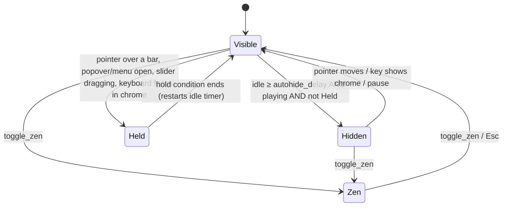

# vihpluh — Design System

Visual identity, tokens, layout metrics, component specs, and interaction rules. The concept follows
Juxtopposed's VLC redesign: dark, flat, compact, orange-accented, with chrome that gets out of the way.
Everything here is a contract for the frontend — no colour, radius, or dimension is invented in component code.

Related: action IDs and shortcuts → [KEYBINDS_AND_CONFIG](KEYBINDS_AND_CONFIG.md); IPC and capabilities → [ARCHITECTURE](ARCHITECTURE.md).

## Contents

1. [Principles](#1-principles) · 2. [Colour](#2-colour) · 3. [Typography](#3-typography) · 4. [Geometry](#4-geometry) ·
5. [Iconography](#5-iconography) · 6. [Window anatomy](#6-window-anatomy) · 7. [Chrome behaviour](#7-chrome-behaviour) ·
8. [Core components](#8-core-components) · 9. [Window modes](#9-window-modes) · 10. [Right dock: sidebar and queue](#10-right-dock-sidebar-and-queue) ·
11. [Library drawer, settings, idle screen](#11-library-drawer-settings-idle-screen) · 12. [Motion](#12-motion) ·
13. [Accessibility and focus](#13-accessibility-and-focus) · 14. [Implementation mapping](#14-implementation-mapping)

---

## 1. Principles

1. **The video is the interface.** Chrome is compact, single-row, and hidden when not needed. Nothing covers the picture that the user didn't summon.
2. **Sharp and utilitarian.** Rectangles with 4–6 px radii. No pills, no circles (except the seek thumb), no gradients, no glassmorphism, no drop shadows for decoration.
3. **One accent.** Orange marks *state* (active, selected, progress, focus) — never decoration. If everything is orange, nothing is.
4. **Direct manipulation.** Sliders over text boxes; changes apply live, with no "Apply" buttons. Every numeric slider also accepts exact typed input.
5. **Keyboard parity.** Anything clickable is bindable, focusable, and shows its shortcut in its tooltip.
6. **Plain English.** Labels say what a thing does ("Subtitle delay", not "sub-delay"). Jargon lives in tooltips and the inspector.
7. **No fluff.** No onboarding, empty-state illustrations, celebratory animation, or modal confirmations for reversible actions (use undo toasts).

---

## 2. Colour

### 2.1 Dark theme (default)

| Token | Value | Use |
|---|---|---|
| `--video-bg` | `#000000` | Letterbox behind video. Same in both themes. |
| `--bg-base` | `#0D0D0F` | Window background (idle screen), deepest layer. |
| `--bg-surface` | `#16161A` | Top bar, bottom bar, dock panels, drawer. |
| `--bg-raised` | `#1E1E24` | Menus, popovers, inputs, cards, list hover base. |
| `--bg-hover` | `#26262E` | Hover on rows and ghost buttons. |
| `--bg-active` | `#2E2E38` | Pressed; selected row background. |
| `--border-subtle` | `#2A2A32` | Dividers, panel edges, input borders. |
| `--border-strong` | `#3A3A45` | Input hover border, menu outline. |
| `--text-primary` | `#EDEDF0` | Body text, values, active icons. |
| `--text-secondary` | `#A8A8B3` | Labels, inactive icons, secondary metadata. |
| `--text-muted` | `#8A8A96` | Hints, placeholders, units. (≥ 4.5:1 on surface and raised.) |
| `--text-disabled` | `#55555F` | Disabled controls. |
| `--accent` | `#FF6B00` | Progress fill, active toggles, selection markers, focus ring. |
| `--accent-hover` | `#FF8126` | Hovered accent surfaces. |
| `--accent-active` | `#E05E00` | Pressed accent surfaces. |
| `--accent-muted` | `rgb(255 107 0 / 0.16)` | Selected-row tint, active tab background, badge fill. |
| `--accent-text` | `#FF7A1A` | Accent-coloured text/icons on dark surfaces. |
| `--on-accent` | `#0D0D0F` | Text/icons **on** an accent fill (dark, 7.4:1). Never white on orange (2.9:1 fails). |
| `--track` | `#3A3A45` | Unfilled slider/seek track. |
| `--track-buffer` | `#5A5A66` | Buffered/cached range on the seek bar. |
| `--danger` | `#F0464A` | Errors, destructive actions, volume boost zone. |
| `--warning` | `#F5B83D` | Warnings, software-decode notice. |
| `--success` | `#3FB96B` | Confirmations (matched subtitles). |
| `--scrim` | `rgb(0 0 0 / 0.55)` | Behind the settings overlay. |
| `--chrome-alpha` | `0.92` | Opacity of bars/panels **when overlaying video** (fullscreen, overlay mode). |

### 2.2 Light theme

| Token | Value | | Token | Value |
|---|---|---|---|---|
| `--bg-base` | `#F4F4F6` | | `--text-primary` | `#17171B` |
| `--bg-surface` | `#FFFFFF` | | `--text-secondary` | `#55555F` |
| `--bg-raised` | `#EDEDF1` | | `--text-muted` | `#6E6E79` |
| `--bg-hover` | `#E4E4EA` | | `--text-disabled` | `#B4B4BE` |
| `--bg-active` | `#D9D9E1` | | `--accent-text` | `#C24E00` (4.8:1 on white) |
| `--border-subtle` | `#DCDCE3` | | `--track` | `#D0D0D9` |
| `--border-strong` | `#C4C4CF` | | `--track-buffer` | `#A9A9B5` |

`--accent`, `--accent-hover`, `--accent-active`, `--on-accent`, `--danger`, `--warning`, `--success`, `--video-bg` are unchanged.
`--accent-muted` becomes `rgb(255 107 0 / 0.14)`. `interface.theme = "system"` follows `prefers-color-scheme`.

### 2.3 Custom accent

`interface.accent` accepts any hex colour (picker in Settings → Interface with 8 swatches + free input).
Derived tokens are computed in `src/lib/color.ts` and written to `:root` at runtime:

| Token | Derivation (OKLCH) |
|---|---|
| `--accent-hover` | lightness + 0.06 |
| `--accent-active` | lightness − 0.07 |
| `--accent-muted` | accent at 16 % alpha (14 % light theme) |
| `--accent-text` | dark theme: lightness raised until ≥ 4.5:1 on `--bg-surface`; light theme: lowered until ≥ 4.5:1 on white |
| `--on-accent` | `#0D0D0F` if contrast with accent ≥ 4.5:1, else `#FFFFFF` |

Swatches: Cone Orange `#FF6B00` (default), Amber `#F5A300`, Red `#E5484D`, Pink `#E93D82`, Violet `#8E4EC6`, Blue `#3E8BFF`, Teal `#12A594`, Green `#46A758`.

---

## 3. Typography

| Token | Stack |
|---|---|
| `--font-ui` | `"Segoe UI Variable Text", "Segoe UI", "Inter", "Cantarell", "Noto Sans", system-ui, sans-serif` |
| `--font-mono` | `"Cascadia Mono", "JetBrains Mono", "Source Code Pro", ui-monospace, monospace` |

System fonts only — nothing is bundled or downloaded.

| Style | Size / line | Weight | Use |
|---|---|---|---|
| `text-xs` | 11 / 16 px | 500 | Section eyebrows (uppercase, +0.06 em tracking), badges, units |
| `text-sm` | 12 / 16 px | 400 | Secondary metadata, tooltips, inspector rows |
| `text-base` | 13 / 20 px | 400 | **Default UI text**: labels, list rows, menu items |
| `text-md` | 14 / 20 px | 500 | Top-bar title, panel titles, tab labels |
| `text-lg` | 16 / 24 px | 600 | Settings category headings, idle screen heading |
| `text-osd` | 20 / 28 px | 600 | OSD value flashes |

- Timecodes, numeric slider values, and the inspector use `font-variant-numeric: tabular-nums` (values must not jitter).
- Inspector/codec values and key caps use `--font-mono` at `text-sm`.
- Sentence case everywhere. No ALL CAPS except `text-xs` eyebrows.
- `interface.ui_scale` (0.8–1.5) multiplies the root font size and every `rem`-based metric.

---

## 4. Geometry

**Spacing scale (px):** `2, 4, 6, 8, 12, 16, 20, 24, 32`. Tokens `--space-0_5 … --space-8`. Nothing off-scale.

**Radii — the only two values:**

| Token | Value | Applies to |
|---|---|---|
| `--radius-control` | `4px` | Buttons, inputs, sliders' tracks, menu items, tabs, tooltips, badges, key caps, thumbnails |
| `--radius-surface` | `6px` | Menus, popovers, cards, dialogs, toasts, the settings panel |

Bars, dock panels, and the drawer are flush to the window edge → radius 0. The seek thumb and toggle knob are the only round elements.

**Borders:** 1 px `--border-subtle` between surfaces. No borders around icon buttons.

**Elevation:** floating surfaces (menus, popovers, toasts, settings) use one shadow, `0 8px 24px rgb(0 0 0 / 0.45)`, plus a 1 px `--border-strong` outline. Bars and panels have no shadow.

**Control sizes:**

| Token | Height | Use |
|---|---|---|
| `--control-sm` | 24 px | Dense rows, inline chips, inspector actions |
| `--control-md` | 28 px | Default inputs, selects, buttons in panels |
| `--control-lg` | 32 px | Icon buttons in the bars |

Minimum pointer target is 28 × 28 px; bar icon buttons are 32 × 32 px.

---

## 5. Iconography

Two families. Never mix them within one role.

### 5.1 Monochrome — interactive controls

- For every clickable control: bar buttons, row actions, menu item glyphs.
- 20 × 20 px grid, 1.5 px stroke, round caps/joins, no fills except play/pause/next/previous (solid glyphs read better at speed).
- Colour is `currentColor`: `--text-secondary` idle → `--text-primary` hover → `--accent-text` when the control's state is **on** (e.g. sidebar open, shuffle enabled).
- Rendered at 18 px in 32 px bar buttons, 16 px in panels and menus.
- Source: `lucide-react` (ISC licence, tree-shaken) for stock glyphs; custom SVGs in `src/icons/mono/` for vihpluh-specific ones
  (`cone-volume`, `queue`, `sidebar-right`, `pip`, `zen`, `frame-step`, `waveform`, `sub-sync`).

### 5.2 Duotone — non-interactive headers

- For section headers, settings categories, sidebar tab headers, library section titles, empty states. **Never on a button.**
- 24 × 24 px grid. Two layers: a base shape in `--icon-duo-base` (`#8A8A96` dark / `#85858F` light, solid fill)
  and a highlight detail in `--accent`. Flat fills, no stroke, no gradients.
- Authored as SVG with `class="duo-base"` / `class="duo-accent"` paths so both layers follow theme and accent tokens.
- Stored in `src/icons/duotone/`. Required set:

| Icon | Base (gray) | Accent (orange) |
|---|---|---|
| `subtitles` | Screen outline block | Two caption lines |
| `audio` | Speaker body | Sound waves |
| `video` | Display | Play triangle |
| `playback` | Dial/gauge | Needle |
| `bookmarks` | Ribbon | Notch/star |
| `queue` | Stacked rows | Top row + play mark |
| `library` | Shelf of spines | One spine |
| `music` | Disc | Note |
| `network` | Globe | Signal arc |
| `recent` | Clock face | Hands |
| `folder` | Folder back | Folder tab/pin |
| `playlist` | List lines | Leading bullet |
| `settings-*` | One per settings category (general, interface, controls, playback, video, audio, subtitles, library, network, performance) | |

### 5.3 App icon

An original mark (working direction: an orange wedge/play triangle on a `#16161A` rounded square, 22 % corner radius per platform norms).
**Not** a traffic cone and not derived from VLC artwork.

---

## 6. Window anatomy

### 6.1 Regions (windowed, right dock open)

```
┌──────────────────────────────────────────────────────────────────────────────┐
│ ▸ Severance · S02E03 — Who Is Alive?                    ☰   ⧉   ─   ☐   ✕  │ TopBar 40
├───────────────────────────────────────────────────────┬──────────────────────┤
│                                                       │ Subs Audio Video ▸ ★ │ tabs 36
│                                                       ├──────────────────────┤
│                                                       │                      │
│                     VIDEO                             │   Right dock         │
│          (native surface under the webview;           │   (Sidebar or Queue) │
│           shrunk with video-margin-ratio)             │   360 px             │
│                                                       │                      │
│                                                       │                      │
├───────────────────────────────────────────────────────┴──────────────────────┤
│ ⏮ ▶ ⏭  12:34 ━━━━━━━━━━━●────────────────── 47:10  ◢▁  ▭ ♪  ☷ ▯  ⛶        │ BottomBar 52
└──────────────────────────────────────────────────────────────────────────────┘
```

| Region | Size | Notes |
|---|---|---|
| TopBar | 40 px high, full width | Drag region. Auto-hides (§7). |
| BottomBar | 52 px high, full width | Single row. Auto-hides (§7). |
| Right dock | 360 px wide (resizable 320–480, `interface.sidebar_width`) | Hosts **one** panel at a time: Sidebar *or* Queue. |
| Library drawer | 380 px wide, left edge, between the bars | Overlays video (never docks). |
| Video viewport | Remaining area | Transparent in the webview; picture positioned by `video_set_margins`. |
| Minimum window | 480 × 270 px | Below 720 px width the bars collapse (§6.4). |

### 6.2 Z-order (webview stacking)

| Layer | z-index | Contents |
|---|---|---|
| Video | — | Native surface below the webview |
| Interaction layer | 0 | Transparent full-viewport element: click, double-click, wheel, drag-to-move, file drop |
| OSD | 10 | Value flashes, shortcut badge |
| Chrome | 20 | TopBar, BottomBar |
| Dock / drawer | 30 | Right dock, Library drawer |
| Floating | 40 | Popovers, menus, context menu, seek preview |
| Overlay | 50 | Settings, shortcuts sheet, command palette (with `--scrim`) |
| Toasts | 60 | Bottom-left stack |
| Tooltip | 70 | |

### 6.3 Dock vs overlay

`interface.sidebar_mode`:

| Value | Windowed | Fullscreen |
|---|---|---|
| `"auto"` (default) | **Dock** — video shrinks, nothing is covered | **Overlay** — panel floats over the right edge at `--chrome-alpha` |
| `"dock"` | Dock | Dock |
| `"overlay"` | Overlay | Overlay |

Docking animates `video-margin-ratio-right` from 0 to `dockWidth / windowWidth` over 160 ms. In dock mode the
bars span the full window width and the dock sits between them.

### 6.4 Responsive collapse (by window width)

| Width | Change |
|---|---|
| ≥ 900 px | Everything shown. |
| 720–899 px | Total-time label hides (elapsed only; click toggles remaining). Cone slider collapses to a mute button with a hover popover slider. |
| 560–719 px | Subtitle + Audio buttons merge into one "Tracks" popover. Previous/Next hide (still on keys and context menu). |
| < 560 px | Queue + Sidebar toggles move into the ☰ menu. Opening a dock panel uses overlay mode. |

---

## 7. Chrome behaviour

### 7.1 Visibility state machine



| Rule | Value |
|---|---|
| Idle delay | `interface.autohide_delay_ms` (default 2000 ms) after the last pointer movement |
| Hides only while | `status == playing`. Paused, idle, loading, error → chrome stays visible |
| Windowed mode | Auto-hide applies when `interface.autohide_in_windowed = true` (default) |
| Fullscreen — bottom bar | Shows on any pointer movement |
| Fullscreen — top bar | Shows **only** when the pointer enters the top 48 px edge zone (so nudging the mouse doesn't flash the title), or on keyboard focus |
| Cursor | Hidden (`cursor: none`) together with the chrome |
| Keyboard actions | Do **not** reveal the bars; they produce an OSD flash instead (§8.9). Exception: `player.show_progress` briefly shows the bottom bar |
| Show / hide motion | Bars translate 8 px + fade: 120 ms in, 200 ms out |
| Dock panels | Not subject to auto-hide; they stay until toggled. In overlay mode they hide with the bars only in Zen |

### 7.2 Zen mode

One key (`Z`) hides **all** chrome: bars, dock, drawer, OSD badges, cursor. Only the picture remains (and
subtitles, which are part of the picture). Pointer movement does nothing. `Z` or `Esc` leaves Zen and restores
exactly the previous layout. Entering Zen shows a 1-second "Zen · Z to exit" OSD, once per session.

### 7.3 Top bar

```
│ [▸ icon] Title — subtitle …                         [☰] [⧉ PiP] │ [─] [☐] [✕] │
  └────────── title button (opens Library drawer) ──┘   └ actions ┘ └ window ctl ┘
```

- **Title button** (left, flexible width, ellipsis): media title (`text-md`, primary) + secondary line element inline
  (series/episode, or folder name, `text-secondary`). A small `chevron-right` precedes it and rotates 90° while the drawer is open.
  Click → `ui.toggle_library`. When idle it reads "Library".
- **☰ Menu** — the single consolidated menu (no menu bar anywhere): Open file… · Open folder… · Open URL… · — ·
  Playback ▸ · Audio ▸ · Subtitles ▸ · Video ▸ · — · Presets ▸ · Settings · Keyboard shortcuts · — · Quit.
  Submenus mirror the context menu (§8.8) — both are generated from the same action list.
- **PiP toggle.**
- **Window controls** (Windows/Linux, right side): minimize, maximize/restore, close. 46 × 40 px each, flat;
  close hover = `--danger` fill with white glyph. Hidden when `interface.window_decorations = "native"` and in fullscreen.
- The whole bar except buttons is a drag region; double-click toggles maximize.

### 7.4 Bottom bar

Single row, 52 px, 8 px horizontal padding, 4 px gaps inside groups, 12 px between groups.

```
│ [⏮][▶/⏸][⏭] │ 12:34 │━━━━━━━━━━━●──────────────│ 47:10 │ [🔈◢▁▁] │ [▭][♪] │ [☷][▯] │ [⛶] │
   transport      time           seek bar            time     volume    tracks   panels   fs
   (LEFT)                      (flex: 1)                               (RIGHT cluster)
```

| Group | Contents | Notes |
|---|---|---|
| **Transport** (left-aligned — *not centred*) | Previous · **Play/Pause** · Next | Play/Pause is 36 × 32 px with a solid 20 px glyph; Previous/Next are 32 px with 16 px glyphs. Previous/Next disabled (not hidden) when the queue has no neighbour. |
| Elapsed | `12:34` / `1:12:34` | Tabular, `text-base`, primary. |
| **Seek bar** | §8.1 | Takes all remaining width (min 160 px). |
| Total / remaining | `47:10` or `−34:36` | Click toggles; stored in `interface.time_display`. |
| **Volume** | Mute button + cone slider (§8.2) | |
| **Tracks** | Subtitle quick selector · Audio quick selector (§8.3) | |
| **Panels** | Queue toggle · Sidebar toggle | Icon turns `--accent-text` while its panel is open. |
| **Fullscreen** | Toggle | Rightmost. |

Background `--bg-surface`; at `--chrome-alpha` with a 1 px top border when overlaying video.

---

## 8. Core components

### 8.1 Seek bar

The most-used control: deliberately thick and forgiving.

| Property | Value |
|---|---|
| Hit area | 28 px tall (full bar-row height band), full width |
| Track thickness | **8 px** resting → **12 px** on hover/drag/keyboard focus (100 ms ease-out) |
| Track radius | `--radius-control` (4 px) — squared-off, not a pill |
| Layers (bottom → top) | `--track` · buffered range `--track-buffer` · played range `--accent` · chapter gaps · bookmark ticks · A–B loop range · hover ghost · thumb |
| Thumb | 14 px circle, `--text-primary` fill, appears on hover/drag/focus only |
| Hover ghost | 1 px `--text-primary` vertical line at the pointer + lighter fill (`rgb(255 255 255 / 0.18)`) from playhead to pointer |
| Chapters | 2 px transparent gaps cut into the track at chapter starts (`interface.seek_chapter_marks`) |
| Bookmarks | 2 × 12 px `--text-primary` ticks rising above the track |
| A–B loop | 2 px `--accent` brackets at A and B; range between tinted `--accent-muted` |
| Waveform mode | With `interface.seek_waveform = true` the track grows to **28 px** and renders the waveform (canvas): played part `--accent`, unplayed `--track-buffer`, on `--bg-raised`. Falls back to the plain track until the waveform is ready (thin 1 px progress line shows generation progress). |

**Hover preview** (floating, above the bar, follows the pointer, clamped to window edges):

```
┌─────────────────────┐
│                     │  thumbnail 240 × 135 (16:9 box, letterboxed), radius 4
│      thumbnail      │  1 px --border-strong outline
└─────────────────────┘
   Chapter 4 · Lumon         text-sm, secondary (only if chapters exist)
        23:41                text-base, tabular, primary
```

- Thumbnail appears when its image loads; until then only the time label shows (no spinner, no layout shift).
- No thumbnail for audio or streams — time/chapter label only.

**Interaction:** click = seek (exact). Drag = scrub: keyframe seeks while dragging (throttled 50 ms), one exact seek on release.
Wheel over the bar = ±`controls.seek_small_s`. Right-click on the bar → mini menu: Add bookmark here · Set loop start (A) · Set loop end (B) · Copy timestamp.
Keyboard focus: ←/→ small seek, Shift ←/→ exact 1 s, Home/End.

### 8.2 Cone volume slider

A right-triangle wedge — the VLC cone silhouette, laid on its side — that fills as volume rises.

```
                                   ◢│  ← boost zone (100–max), --danger when filled
                           ◢████████│
                   ◢████████████████│     width 72 px · height 20 px
           ◢▓▓▓▓▓▓▓▓▓▓▓▓▓▓▓▓▓▓▓▓▓▓▓│     filled part --accent, unfilled --track
   [🔈] ◢▓▓▓▓▓▓▓▓▓▓▓▓▓▓▓▓▓▓▓▓▓▓▓▓▓▓│
   mute  0 %                    100 %│130 %
```

| Property | Value |
|---|---|
| Shape | SVG polygon `0,20 72,20 72,0` with 1.5 px rounded joins; rendered as a clip path over two rects (track + fill) |
| Range | 0 – `audio.max_volume` (default 130). 100 % sits at `100 / max` of the width with a 1 px notch in `--bg-surface` |
| Fill | `--accent` up to 100 %; the portion above 100 % is `--danger` |
| Hit area | 72 × 32 px (full row height), so the thin tip is still easy to grab |
| Interaction | Click/drag sets volume; wheel anywhere on the group ±`controls.volume_step`; double-click resets to 100 %; ←/→ when focused |
| Mute button | 32 px icon button left of the cone: `volume-x` (muted) / `volume-1` (< 50) / `volume-2`. When muted the cone fill turns `--text-disabled` but keeps its level |
| Tooltip | "Volume 85 % · ↑/↓ · M to mute" |

### 8.3 Quick track selectors

Two 32 px icon buttons that open **popovers** (anchored above the button, 280 px wide, max 360 px tall, scrollable).

**Subtitles popover**

```
┌──────────────────────────────────┐
│ SUBTITLES                    [⚙] │  ⚙ → opens Sidebar · Subtitles tab
│ ○ Off                            │
│ ● English · Full      ASS        │  selected: accent dot + accent-muted row
│ ○ English · Signs     ASS  forced│
│ ○ Spanish             SRT  ext   │  badges: codec, forced, ext(ernal), default
│──────────────────────────────────│
│ + Add subtitle file…             │
│ ⟲ Auto-match folder subtitles    │
└──────────────────────────────────┘
```

**Audio popover** — two sections in one popover: **Audio track** (same row format: language · title · `E-AC-3 5.1`)
and **Output device** (list of devices from `audioDevices`, current one checked; "System default" first). A ⚙ jumps to Sidebar · Audio.

Rows are 28 px; ↑/↓ move, Enter selects, the popover stays open after selecting (so you can hear/see the change) and closes on Esc or outside click.
The button icon shows a small accent dot when a non-default state is active (subs on / non-default device).

### 8.4 Buttons

| Variant | Look | Use |
|---|---|---|
| **Icon button** | No background; icon `--text-secondary`. Hover: `--bg-hover` square + `--text-primary`. Pressed: `--bg-active`. On: icon `--accent-text`. | Bars, row actions |
| **Ghost** | Text `--text-primary`, no background; hover `--bg-hover` | Secondary actions in panels |
| **Secondary** | `--bg-raised` fill, 1 px `--border-subtle`; hover border `--border-strong` | Default panel button |
| **Primary** | `--accent` fill, `--on-accent` text; hover `--accent-hover`; pressed `--accent-active` | At most one per view (Save preset, Apply match) |
| **Danger** | Text `--danger`; hover `rgb(240 70 74 / 0.14)` | Delete preset, Clear history |

All: radius 4 px, height per §4, `text-base` weight 500, 8–12 px horizontal padding, 6 px icon–label gap. Disabled: `--text-disabled`, no hover.

### 8.5 Slider + exact value (the standard parameter row)

Every tunable number (delays, sizes, brightness, speed, EQ preamp…) uses this row:

```
Subtitle delay                                   [ −350 ms ] ⟲
├────────────────────●───────────────────────────┤
−5 s                 0                          +5 s
```

| Part | Spec |
|---|---|
| Label | `text-base`, secondary. Optional ⓘ tooltip. |
| Value field | Right-aligned, 72 px, mono/tabular. Click to type an exact value; ↑/↓ step, Shift = ×10, Alt = fine (÷10). Enter commits, Esc reverts. |
| Reset ⟲ | 24 px icon button, visible only when value ≠ default |
| Track | 4 px thick, radius 2 px (visually sharp), `--track`; fill `--accent` **from the default/zero point** for bipolar ranges (so 0 is visually obvious), from the left for unipolar |
| Thumb | 12 × 16 px rounded rectangle (radius 3 px), `--text-primary`; hover/drag grows to 14 × 18 |
| Detents | Snaps at the default value (6 px magnetic zone); tick marks at detents |
| Behaviour | Live while dragging (throttled 30 ms). Double-click thumb = reset. Wheel over the row = one step (only when the row is hovered **and** focused, to avoid accidental scroll changes). |

### 8.6 Toggles, selects, segmented controls, tabs

| Component | Spec |
|---|---|
| **Toggle** | 32 × 18 px track, radius 4 px (rectangular switch, not a pill); knob 14 × 14 px, radius 3 px. Off: `--track` + `--text-secondary` knob. On: `--accent` + `--on-accent` knob. |
| **Checkbox** | 16 px, radius 3 px, 1 px `--border-strong`; checked `--accent` fill, `--on-accent` check. |
| **Select** | `--control-md`, `--bg-raised`, chevron right; opens a menu (§8.7). |
| **Segmented control** | Group in a `--bg-raised` container (radius 4, 2 px padding); selected segment `--bg-active` + `--text-primary`, with a 2 px `--accent` underline. For 2–5 mutually exclusive options (S / M / L / XL, Fit / Fill / Stretch). |
| **Tabs** (dock) | 36 px row; each tab = mono icon + label (label hides below 340 px dock width). Active: `--text-primary`, `--accent-muted` background, 2 px `--accent` bottom border. Inactive: `--text-secondary`. |
| **Chip / badge** | 18 px high, radius 4, `text-xs`; neutral `--bg-active`/`--text-secondary`; accent `--accent-muted`/`--accent-text`. |
| **Key cap** | Mono `text-xs`, `--bg-raised`, 1 px `--border-strong`, radius 4, 2 × 6 px padding. Used in tooltips, menus, hotkey editor. |

### 8.7 Menus and popovers

- Surface: `--bg-raised`, radius 6 px, 1 px `--border-strong`, elevation shadow, 4 px padding.
- Item: 28 px, radius 4 px, 8 px padding; layout `[16 px icon] label ……… [key cap(s)] [▸]`. Hover/focus `--bg-hover`. Checked items show an accent check/dot in the icon slot.
- Section header: `text-xs` eyebrow, muted, 8 px top padding. Separator: 1 px `--border-subtle`, 4 px vertical margin.
- Every menu item that maps to an action shows that action's current shortcut, right-aligned, live from the keymap.
- Opens in 80 ms (fade + 4 px rise); closes instantly. Type-ahead, ↑/↓, →/← for submenus, Esc.

### 8.8 Context menu (right-click on video)

Mirrors essentials only — one screen, no scrolling:

```
Play / Pause                     Space
Next                             N
Previous                         P
────────────────────────────────
Audio track                      ▸     (tracks, then output devices)
Subtitles                        ▸     (Off, tracks, Add file…, Auto-match)
Speed                            ▸     (0.5 · 0.75 · 1.0 · 1.25 · 1.5 · 2.0)
Aspect ratio                     ▸
────────────────────────────────
Add bookmark                     Ctrl+B
Take screenshot                  S
────────────────────────────────
Picture-in-picture               Ctrl+P
Zen mode                         Z
Fullscreen                       F
────────────────────────────────
Open file…                       Ctrl+O
Show in file manager
Settings                         Ctrl+,
```

Right-click on queue rows, library items, bookmarks, and the seek bar opens their own small menus.

### 8.9 OSD and toasts

**OSD flash** — feedback for keyboard/wheel actions while chrome is hidden. Top-centre (`interface.osd_position`), 16 px from the top (below the top bar if visible).

```
┌───────────────────────────┐
│ 🔈  Volume  ▓▓▓▓▓▓▓░░  85 %│   icon · label · optional mini bar · value (text-osd, tabular)
└───────────────────────────┘      surface: --bg-surface at 0.92, radius 6, 8 × 12 px padding
```

- One OSD at a time; a new one replaces the old in place (no stacking). Visible `interface.osd_duration_ms` (1200 ms), 120 ms fade.
- **Shortcut badge** (`interface.osd_shortcut_badge`, default off): a key cap appended at the right — `… 85 %  [↑]` —
  showing the exact shortcut that triggered the action. For actions with no value, the OSD is `icon · action label · [key]`.
- Seeking OSD shows `12:34 / 47:10` plus a thin progress bar.

**Toasts** — for things that need reading or have an action. Bottom-left, above the bottom bar, stack up to 3, 320 px wide,
`--bg-raised`, radius 6. Layout: `[status icon] message  [Action]  [✕]`. Auto-dismiss 5 s (errors persist until dismissed).
Examples: "Resumed at 12:34 · **Start over**", "Bookmark added at 23:41 · **Rename**", "Removed 3 items from queue · **Undo**",
"Software decoding — no hardware decoder for AV1 · **Details**".

### 8.10 Tooltips

Appear after 500 ms hover (immediately when moving between adjacent controls), `--bg-raised`, radius 4, `text-sm`, max 240 px.
Format: `Label  [key cap]`. Settings info tooltips (ⓘ) may run to two sentences. Never placed over the video centre; prefer above bar controls.

### 8.11 Lists and rows

- Row height 32 px (dense lists: queue, tracks, bookmarks) or 44 px (two-line: library items, recents).
- Hover `--bg-hover`; selected `--accent-muted` with a 2 px `--accent` left bar; currently playing item: accent title + animated 3-bar level glyph (static when paused).
- Row actions (remove, more) appear on hover/focus at the right; always reachable by keyboard and context menu.
- Lists over 100 rows are virtualised. Scrollbars: 8 px, thumb `--border-strong`, radius 4, no track; overlay style.
- Drag reorder: dragged row lifts (`--bg-raised` + shadow), a 2 px `--accent` insertion line shows the drop position.

---

## 9. Window modes

| Mode | Chrome | Behaviour |
|---|---|---|
| **Normal** | Full | Custom title bar by default. Resizable from edges (6 px invisible resize zones; corners 12 px). |
| **Maximized** | Full | Top bar stays; drag from the top bar restores. |
| **Fullscreen** | Auto-hide; top bar edge-hover only; no window controls | `F` / `F11` / double-click. `Esc` exits. Dock opens as overlay (`auto`). |
| **Picture-in-picture** | Compact (below) | Same window, transformed — not a second window. |
| **Zen** | None | Orthogonal flag; combinable with any mode (§7.2). |

### Picture-in-picture

- Entering: remember geometry → switch to borderless always-on-top → resize to `interface.pip_width` (default 480 px, height from video aspect)
  → move to `interface.pip_corner` (default bottom-right, 24 px from the work-area edges).
- Chrome in PiP (shown on hover only): a 28 px bottom strip with Play/Pause, a 4 px seek line (8 px on hover), and at top-right
  two 24 px buttons: **Restore** and **Close**. No dock, no drawer, no top bar. The whole surface drags the window; edges resize keeping aspect. Minimum 240 × 135.
- Leaving (`Ctrl+P`, Restore, `Esc`): restore previous geometry and mode.
- **Wayland:** clients cannot position windows or keep themselves on top. When `capabilities.window_positioning` /
  `always_on_top` are false, PiP only resizes and switches chrome; a one-time toast says
  "Wayland: use your compositor's 'Always on Top' for this window". No fake workaround.

---

## 10. Right dock: sidebar and queue

The dock header is the tab row: **Subtitles · Audio · Video · Playback · ★ Bookmarks**, plus a close button.
The Queue panel replaces the tab row with a "Queue" title bar. Body scrolls; sections are separated by 16 px and a `text-xs` eyebrow.
A **preset strip** sits at the bottom of every tab (§10.6).

### 10.1 Subtitles tab

```
TRACK        [ English · Full (ASS)                      ▾ ]   [👁 visible]
             + Add file…      ⟲ Auto-match folder

SYNC
 Subtitle delay                                   [ −350 ms ] ⟲
 ├───────────────●─────────────────────────────┤
 ┌──────────────────────────────────────────────────────────┐
 │ ▁▂▅▇▅▂▁▁▃▆█▆▃▁▁▁▂▅▇▅▂▁▁▁▁▃▆█▆▃▁   waveform (±8 s window)   │
 │   ┌──────────┐      ┌───────────────┐    ┌───────┐       │ ← cue blocks, draggable
 │   │I told you│      │We're not done.│    │ Run!  │       │
 │   └──────────┘      └───────────────┘    └───────┘       │
 │                 ▲ playhead (fixed centre)                │
 └──────────────────────────────────────────────────────────┘
   [⇤ Prev cue to now]  [Next cue to now ⇥]      zoom [−][+]

STYLE
 Font         [ Segoe UI                       ▾ ]  [B]
 Size         [ 42 ]   ( S | M | L | XL )
 Text colour  [■ #FFFFFF]   Outline [■ #000000]  Outline size ├──●──┤ [3.0]
 Background   ( None | Box )
 Position     ├──────────────────────●─┤ [ 96 % ]
 Embedded styles (ASS)   ( Keep | Scale | Override | Strip )  ⓘ
```

**Subtitle timeline** (the centrepiece):

| Aspect | Spec |
|---|---|
| Size | Full dock width × 96 px; `--bg-raised`, radius 4 |
| Time window | ±8 s around the playhead by default; zoom steps ±4 / ±8 / ±15 / ±30 s |
| Playhead | Fixed vertical 1 px `--accent` line at the centre; content scrolls under it during playback |
| Waveform | Top 56 px, `--text-muted` bars (canvas, from the `.vwf` peaks). Placeholder: flat line + "Analysing audio… 42 %" |
| Cue blocks | Bottom 32 px lane; blocks `--bg-active`, 1 px `--border-strong`, radius 4, `text-xs` text truncated; the cue under the playhead is `--accent-muted` with accent border |
| **Drag cues horizontally** | Shifts **all** cues — i.e. changes subtitle delay live. The delay slider and value field update together. Snap: holding Shift snaps the nearest cue start to the nearest waveform onset |
| Drag waveform area | Scrubs playback (seek) |
| Buttons | "Prev/Next cue to now" = `sub_step ∓1` — aligns that cue's start with the current position (the fastest way to sync by ear) |
| Unknown regions | Diagonal hatch in `--border-subtle` where `coverage != "full"` (§ARCHITECTURE 11.3); bitmap subs show unlabeled blocks |

**Auto-match** opens an inline result card: "Matched 11 of 12 episodes" with a collapsible list
(video → subtitle, language chip), unmatched/ambiguous rows flagged in `--warning`, and one **Apply** primary button.

Font picker lists installed families (`fonts_list`), each rendered in its own face. Size presets S/M/L/XL set
`scale` 0.8 / 1.0 / 1.25 / 1.5; the numeric field sets the exact base size.

### 10.2 Audio tab

```
TRACK        [ Japanese · FLAC 2.0                       ▾ ]
OUTPUT       [ Speakers (Realtek)                        ▾ ]
DEFAULT LANGUAGE   [ jpn, eng ]  ⓘ  (edits audio.preferred_languages)

SYNC
 Audio delay                                      [   0 ms ] ⟲
 ├──────────────────────●──────────────────────┤

EQUALIZER                                   [on ▮]  ( 10-band | Parametric )
 ┌──────────────────────────────────────────────────────────┐
 │ +12                                                      │
 │        ●───●                                             │   response curve (accent line,
 │   ●───╯     ╲●───●───●───●                    ●          │   accent-muted fill to 0 dB)
 │  0 ─────────────────────────╲●───●───●───────╱───        │
 │ −12                                                      │
 │   31  62  125  250  500  1k  2k  4k  8k  16k             │
 └──────────────────────────────────────────────────────────┘
 Preamp  ├───────────●───────────┤ [ −2.0 dB ]
 PRESETS  [Flat][Bass][Treble][Dialogue][Night][Loudness][Rock][Classical] [+ Save]
 Volume normalisation   [off ▯]  ⓘ
```

- **10-band mode:** ten vertical faders embedded in the graph (drag a node up/down, ±12 dB, 0.5 dB steps; double-click = 0).
  Frequencies: 31, 62, 125, 250, 500, 1 k, 2 k, 4 k, 8 k, 16 k Hz.
- **Parametric mode:** up to 8 nodes; drag = frequency (x, log scale) + gain (y); wheel = Q; right-click node = type (Peak / Low shelf / High shelf) or delete; double-click empty area adds a node.
- **Visual presets:** each preset chip is a 56 × 28 px button drawing that preset's curve as a tiny sparkline above its name; the active one has an accent border. User presets append after the built-ins.
- The curve is the true summed response (computed in `src/lib/eq.ts` from biquad coefficients), not a spline through the nodes.

### 10.3 Video tab

```
PICTURE
 Brightness ├──────────●──────────┤ [  0 ] ⟲      Contrast   … Saturation … Gamma … Hue …
TRANSFORM
 Aspect   ( Auto | 16:9 | 4:3 | 21:9 | 2.39 | Stretch | Fill )
 Rotate   [⟲ 90°] [⟳ 90°]      Flip  [⇋ H] [⇅ V]
 Zoom     ├──●──────────────────┤ [ 1.00× ]     (drag the video with Alt held to pan)
HDR
 Tone mapping   [ Auto ▾ ]  ⓘ        HDR passthrough: active / unavailable  (status chip)
ENHANCE
 Debanding [▯]   Motion interpolation [▯]
SHADERS
 ☐ Anime4K_Clamp_Highlights.glsl      ☐ FSRCNNX_x2_8-0-4-1.glsl      [Open shaders folder]
                                                     [ Reset all video settings ]
```

All controls preview live on the running picture. Options the current backend cannot do are hidden based on
`capabilities` (e.g. gpu-next-only tone curves on Linux), never shown disabled without explanation.

### 10.4 Playback tab

```
SPEED     ├──────────●──────────┤ [ 1.00× ]   [0.5][0.75][1][1.25][1.5][2]
STEP      [◀▮ Frame back] [Frame forward ▮▶]     Reverse playback [▯] ⓘ
LOOP      ( Off | File | A–B )   A [12:01.250]  B [12:09.800]  [Set A][Set B][Clear]
SLEEP     ( Off | 15 | 30 | 45 | 60 min | End of file | End of queue )   · 23:10 left
SEEK BAR  Waveform [▯]   Thumbnails [▮]   Chapter marks [▮]

STREAM INFO                                                        [Copy all]
 Video    HEVC Main 10 · 3840×2160 · 23.976 fps · HDR10 (BT.2020/PQ) · 58.4 Mb/s
 Decoder  d3d11va (hardware, zero-copy)            Dropped 0 · Delayed 0
 Audio    E-AC-3 5.1 · 48 kHz · 768 kb/s → WASAPI 5.1
 Subs     ASS · eng · "Full"
 File     Matroska · 14.2 GB · D:\Shows\…\S02E03.mkv           [Show in folder]
 Cache    18 s ahead · 212 MiB
```

Inspector rows are `text-sm` mono values with secondary labels, selectable text, refreshed at 2 Hz only while this tab is visible.

### 10.5 Bookmarks tab — unified timeline

One chronological list mixing **chapters** (from the file) and **bookmarks** (yours):

```
[+ Add bookmark at 23:41]                           ( All | Chapters | Bookmarks )
 ▸ 00:00   Chapter 1 · Cold Open                    ▭
 ★ 03:12   That one shot                            ✎ ✕
 ▸ 04:55   Chapter 2 · Opening                      ▭
 ★ 23:41   Bookmark 2                               ✎ ✕      ← current position highlighted
```

- Chapters: mono `chevron` marker, secondary text, read-only. Bookmarks: accent `★`, primary text, rename inline (Enter), delete with undo toast.
- Click a row = seek there. The row containing the current position has the accent left bar.
- `Ctrl+B` adds a bookmark at the current position with an auto label ("Bookmark 3"), flashes an OSD, and never opens anything.
- Hovering a row shows that position's thumbnail in the standard preview card.

### 10.6 Preset strip (bottom of every sidebar tab)

```
│ ◉ Preset: Frieren  (series)  •modified      [Update] [Save as…] [⋯] │   40 px, --bg-raised top border
```

- Shows the most specific applied preset (or "No preset"). A `--warning` dot + "modified" appears when `presetDirty`.
- **Update** writes the current differences into that preset. **Save as…** opens a compact popover:
  name, applies-to (`This series: "sousou no frieren"` / `This folder` / `This folder and subfolders` / `Custom pattern`),
  and four checkboxes for which sections to include (Audio, Subtitles, Video, Playback). One primary **Save**.
- **⋯**: Detach for this file · Manage presets… (opens Settings → Playback → Presets) · Reveal preset file.

### 10.7 Queue panel

```
QUEUE · 12 items · 7 h 42 m                    [🔀] [🔁] [⋯]   [✕]
 ⠿ ▮▮▮ S02E03 — Who Is Alive?            47:10          ← playing: accent title + level glyph
 ⠿     S02E04 — Woe's Hollow              44:32   ✕
 ⠿     S02E05 — Trojan's Horse            49:01   ✕
 ─ ─ ─ drop files here to add ─ ─ ─
```

- 32 px rows: drag handle (on hover), title, duration, remove. Double-click / Enter plays. Multi-select with Shift/Ctrl.
- Drag to reorder; drop files/folders from the OS **anywhere on the window** to enqueue (onto the panel = at the drop position; onto the video = replace, or enqueue if Shift is held — a drop hint overlay states which).
- Header actions: Shuffle, Repeat (off → all → one), ⋯ = Save as playlist… · Stop after current · Clear.
- Items auto-added from a folder show a subtle `folder` chip until the queue is edited.
- Row context menu: Play · Play next · Remove · Show in folder · Add to playlist ▸.

---

## 11. Library drawer, settings, idle screen

### 11.1 Library drawer

Slides in from the left (380 px, between the bars, overlays video at `--chrome-alpha`). Playback continues untouched.

```
┌─────────────────────────────────────────┐
│ [🔍 Search library…              Ctrl+F]│
│ ┌─────┬─────┬───────┬──────┬──────┬───┐ │   section switcher: duotone icon + label,
│ │Video│Music│Streams│Recent│Folders│ ≡ │ │   active = accent underline   (≡ = Playlists)
│ └─────┴─────┴───────┴──────┴──────┴───┘ │
│ ( All | Series | Folders )              │   per-section view switch (segmented)
│ ▸ Severance                    2 seasons│
│ ▸ Sousou no Frieren               28 ep │   44 px rows: title + meta, progress bar (2 px accent)
│   Blade Runner 2049            2 h 44 m │   under partially-watched items
│  …                                      │
└─────────────────────────────────────────┘
```

| Section | Views |
|---|---|
| **Videos** | All · Series (grouped by series → season → episodes) · Folders |
| **Music** | Albums (grid of text cards: album / artist / year — no artwork fetching) · Artists · Tracks |
| **Streams** | Sources → groups → channels; "+ Add M3U…" and "Open URL…" at top |
| **Recent** | Last played with resume progress; "Clear history" in ⋯ |
| **Folders** | Pinned folders as shortcuts → live folder browser (breadcrumb) with a 📌 toggle |
| **Playlists** | Saved playlists; open one to view/reorder/rename |

Item interaction: **Enter / double-click = play now (replace queue)**; `Shift+Enter` = play next; `Ctrl+Enter` = add to queue;
hover reveals `▶` and `+` row buttons; right-click for the full menu. A watched item shows a muted check; partially watched shows the 2 px progress line.
The drawer stays open after enqueueing (browse-while-playing) and closes on Esc, the title button, or outside click.

### 11.2 Settings overlay

Centred panel over `--scrim`, max 920 × 640 px, radius 6. Playback continues behind it.

```
┌───────────────┬───────────────────────────────────────────────────┐
│ 🔍 Search…    │ Subtitles                                          │
│               │ ───────────────────────────────────────────────── │
│ ◧ General     │ Preferred languages   [ eng, en            ]  ⓘ   │
│ ◧ Interface   │ Show subtitles by default            [▮]      ⓘ   │
│ ◧ Controls    │ Load matching subtitle files   [ Similar names ▾ ] │
│ ◧ Playback    │ …                                                  │
│ ◧ Video       │                                                    │
│ ◧ Audio       │                                                    │
│ ◧ Subtitles ◂ │                                                    │
│ ◧ Library     │                                                    │
│ ◧ Network     │                                                    │
│ ◧ Performance │                             [Reset this page]      │
└───────────────┴───────────────────────────────────────────────────┘
```

- Left rail 200 px: search field + ten categories (duotone icons). Right: one scrolling page per category.
- **Row anatomy:** plain-English label (primary) · ⓘ info tooltip (what it does and when you'd change it) · control right-aligned.
  A row whose value differs from default shows a 6 px accent dot left of the label and a ⟲ on hover.
- **Search** filters across all categories by label, tooltip text, and keywords; results are grouped by category with matches highlighted; the rail dims non-matching categories.
- Changes apply and save immediately. No OK/Cancel/Apply. The few settings needing a restart show an inline `--warning` chip: "Applies after restart".
- **Controls** hosts the hotkey editor (KEYBINDS_AND_CONFIG §4).
- Footer of the rail: "Open config folder" · version string (mono, muted). Nothing else — no about page, no links out.

### 11.3 Idle screen (no media)

`--bg-base` background, centred column, max 520 px:

```
        Drop files here, or  [Open file…  Ctrl+O]   [Open folder…]   [Open URL…]

        CONTINUE WATCHING
        ▸ Severance · S02E03                12:34 / 47:10  ━━━━───────
        ▸ Sousou no Frieren - 05             3:02 / 24:10  ━─────────
        RECENT FOLDERS
        📁 D:\Shows\Severance\Season 2
```

Up to 5 resumable items and 3 folders (from `history`), each a 44 px row. Enter on the first row is the default action.
If history tracking is off, only the open buttons show. No logo splash, no tips.

---

## 12. Motion

| Token | Value | Use |
|---|---|---|
| `--dur-instant` | 80 ms | Hover fills, menu open, tooltip |
| `--dur-fast` | 120 ms | Chrome show, OSD, toggles, thumb growth |
| `--dur-base` | 160 ms | Dock/drawer slide, video margin animation |
| `--dur-slow` | 200 ms | Chrome hide, overlay scrim |
| `--ease-out` | `cubic-bezier(0.2, 0, 0, 1)` | Entrances, expansions |
| `--ease-in` | `cubic-bezier(0.4, 0, 1, 1)` | Exits |

- Animate only `opacity` and `transform` (plus the mpv video margin). Never animate layout properties or anything that reflows.
- No bounce, no spring, no parallax, no looping animation other than the "now playing" level glyph and progress indicators.
- `interface.reduce_motion` (`system` / `on` / `off`): when reduced, all durations become 0 ms except opacity fades at 80 ms.

---

## 13. Accessibility and focus

- **Contrast:** text ≥ 4.5:1, icons and control boundaries ≥ 3:1 against their surface, in both themes and for any custom accent (derivation in §2.3 enforces it).
- **Focus ring:** `outline: 2px solid var(--accent); outline-offset: 2px`, shown on `:focus-visible` only. Never removed.
- **Player focus model** (critical for a keyboard-driven player):
  - Default focus is the *player root*. Single-key shortcuts are live.
  - **Pointer clicks never leave focus on chrome buttons** (bar buttons blur back to the player root after activation), so pressing Space after clicking Mute still toggles playback.
  - `Tab` / `Shift+Tab` move keyboard focus into and through the chrome (bars → dock → drawer). While a control has keyboard focus, its native keys (Space, Enter, arrows) go to it; all other shortcuts still work.
  - `Esc` returns focus to the player root (then continues the escape chain: close popover → close overlay/drawer → leave Zen → leave PiP → leave fullscreen).
  - In text inputs only shortcuts with Ctrl/Alt (and Esc) fire.
- Every control has an `aria-label`; toggles expose `aria-pressed`; sliders expose `role="slider"` with value text ("Volume 85 percent", "Subtitle delay minus 350 milliseconds").
- Menus, popovers, tabs, and dialogs get roving focus, type-ahead, and focus trapping from Radix primitives.
- Nothing conveys state by colour alone: active toggles also change icon/shape; errors carry an icon and text.
- Target size ≥ 28 px; `interface.ui_scale` up to 1.5 for high-DPI/couch use.

---

## 14. Implementation mapping

**`src/styles/tokens.css`** defines every token in this document as a CSS custom property on `:root`
(dark values), overridden under `:root[data-theme="light"]`. Theme and accent are applied by setting
`data-theme` and the accent-derived properties on `document.documentElement` from `stores/config.ts`.

**Tailwind 4** consumes the tokens through `@theme` so utilities map 1:1:

```css
@theme {
  --color-base: var(--bg-base);        --color-surface: var(--bg-surface);
  --color-raised: var(--bg-raised);    --color-hover: var(--bg-hover);
  --color-active: var(--bg-active);    --color-line: var(--border-subtle);
  --color-line-strong: var(--border-strong);
  --color-fg: var(--text-primary);     --color-fg-2: var(--text-secondary);
  --color-fg-3: var(--text-muted);     --color-fg-off: var(--text-disabled);
  --color-accent: var(--accent);       --color-accent-soft: var(--accent-muted);
  --color-accent-fg: var(--accent-text); --color-on-accent: var(--on-accent);
  --color-danger: var(--danger);       --color-warning: var(--warning);  --color-success: var(--success);
  --radius-control: 4px;               --radius-surface: 6px;
  --font-sans: var(--font-ui);         --font-mono: var(--font-mono);
}
```

**Rules for component code**

- Colours only via the utilities above (`bg-surface`, `text-fg-2`, `border-line`…). No hex, no `rgb()`, no Tailwind palette colours (`orange-500`).
- Radii only `rounded-control` / `rounded-surface` (and `rounded-full` solely for the seek thumb). `rounded-full` on buttons, chips, inputs, or tracks is a review-blocking error.
- Spacing from the scale in §4. Heights from the control tokens.
- The page root, `html`, and `body` stay `background: transparent`; only explicit surfaces paint pixels. The idle screen paints `bg-base`.
- Canvas-drawn components (waveform, EQ curve, seek-bar waveform) read colours from computed CSS variables and redraw on `config://changed` for theme/accent.
- Primitives live in `src/components/`; features compose them and never restyle their internals.
